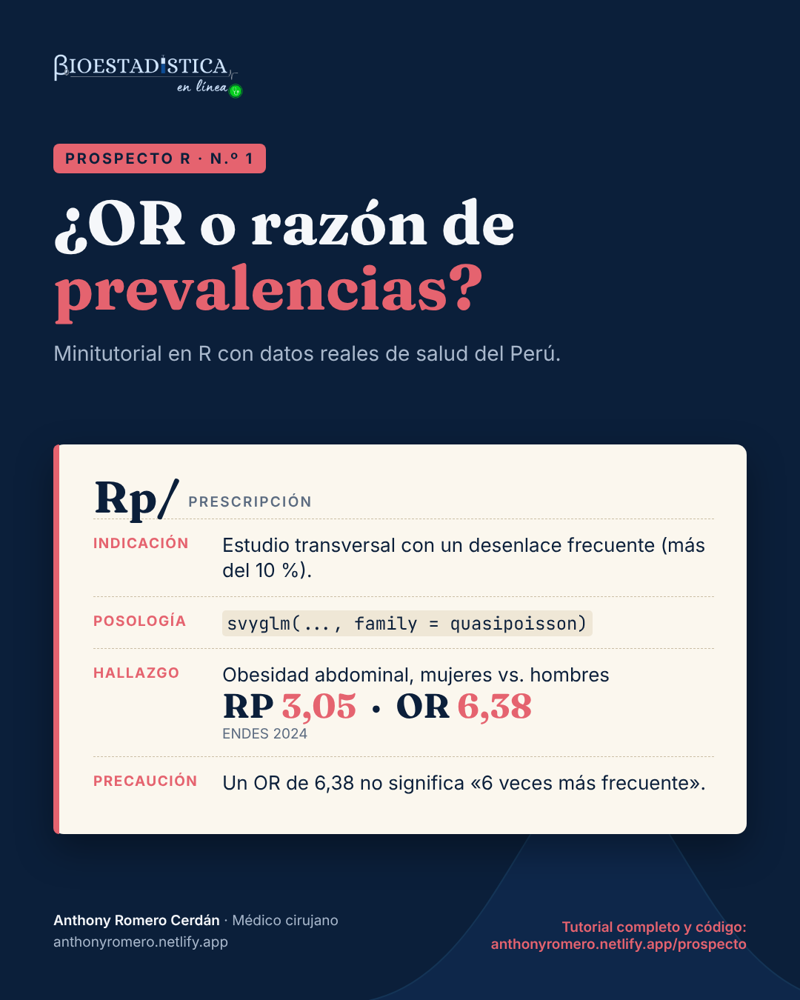

```{r}
#| label: configuracion
#| include: false
options(OutDec = ",")
knitr::opts_chunk$set(comment = "#>", fig.align = "center")
# formato de números para el texto: siempre con coma decimal
fmt <- function(x, d = 2) formatC(x, format = "f", digits = d, decimal.mark = ",", big.mark = "\u00a0")
pct <- function(x, d = 1) paste0(fmt(100 * x, d), "\u00a0%")  # espacio que no se separa
```

{fig-alt="Receta del Prospecto R n.º 1 con la indicación, la posología, el hallazgo y la precaución" width="440" fig-align="center"}

::: {.callout-note appearance="minimal"}
**Prospecto R** es una serie de minitutoriales de análisis de datos de salud en R. Cada entrega responde una pregunta concreta con datos reales del Perú, explica la teoría mínima necesaria y muestra el código completo con sus resultados. Las cifras de este texto se calculan al compilar el documento: no se escriben a mano.
:::

| | |
|---|---|
| **Pregunta** | ¿Qué medida de asociación reporto en un estudio transversal con un desenlace frecuente? |
| **Datos** | ENDES 2024, Cuestionario de Salud (INEI) |
| **Paquetes** | `data.table`, `survey`, `ggplot2` |
| **Requisitos** | Saber qué es una prevalencia y haber ajustado una regresión logística |

## Indicación

Estás analizando un estudio **transversal** con un desenlace **binario** (sí/no) y quieres cuantificar su asociación con una exposición. Si el desenlace es frecuente (como regla práctica, más del 10&nbsp;%), la medida que responde directamente a tu pregunta es la **razón de prevalencias (RP)**, no el odds ratio (OR).

## Composición

En un estudio transversal mides la prevalencia del desenlace en expuestos ($P_1$) y en no expuestos ($P_0$). Con esas dos prevalencias puedes construir dos medidas:

$$
\text{RP} = \frac{P_1}{P_0}
\qquad\qquad
\text{OR} = \frac{P_1/(1-P_1)}{P_0/(1-P_0)}
$$

La RP compara **proporciones**: "la prevalencia en expuestos es *k* veces la de no expuestos". El OR compara **odds** (chances), una escala que casi nadie interpreta de forma intuitiva. Las dos medidas se relacionan así:

$$
\text{OR} = \text{RP} \times \frac{1-P_0}{1-P_1}
$$

Si el desenlace es raro, $P_0$ y $P_1$ están cerca de 0, la fracción vale casi 1 y el OR se parece a la RP. Si el desenlace es frecuente, la fracción crece y el OR **se aleja de 1 más que la RP**. La regresión logística estima un OR, así que en un estudio transversal con desenlace frecuente exagera la asociación si la lees como una razón de prevalencias.

```{r}
#| label: fig-teoria
#| fig-cap: "Para una misma razón de prevalencias, el OR crece a medida que el desenlace es más frecuente."
#| fig-width: 7
#| fig-height: 4
#| code-fold: true
#| code-summary: "Código de la figura"
library(ggplot2)
teoria <- expand.grid(p0 = seq(0.01, 0.30, by = 0.005), rp = c(1.5, 2, 3))
teoria$p1 <- teoria$p0 * teoria$rp
teoria$or <- with(teoria, (p1 / (1 - p1)) / (p0 / (1 - p0)))
ggplot(teoria, aes(p0, or, colour = factor(rp))) +
  geom_hline(aes(yintercept = rp, colour = factor(rp)), linetype = "dashed") +
  geom_line(linewidth = 1) +
  scale_x_continuous("Prevalencia en no expuestos (P0)",
                     labels = scales::label_percent(decimal.mark = ",", suffix = "\u00a0%")) +
  scale_y_continuous("Odds ratio", labels = scales::label_number(decimal.mark = ",")) +
  scale_colour_manual("Razón de prevalencias", values = c("#4FC3C8", "#7FB2F0", "#E5636F")) +
  theme_minimal(base_size = 13) +
  theme(legend.position = "top")
```

Las líneas punteadas marcan la RP real. Con una RP de 3 y una prevalencia de 20&nbsp;% en no expuestos, el OR ya es `r fmt(with(subset(teoria, rp == 3 & abs(p0 - 0.20) < 1e-9), or), 1)`.

## Posología

El ejemplo usa la ENDES 2024 para responder: **¿cuánto más frecuente es la obesidad abdominal en las mujeres que en los hombres?** La ENDES es una encuesta con diseño muestral complejo, así que el análisis debe incluir los pesos, los conglomerados y los estratos.

### Paso 1. Descarga los datos

En el portal de microdatos del INEI (<https://proyectos.inei.gob.pe/microdatos/>), elige *Consulta por encuestas*, luego ENDES y el año 2024, y descarga en formato CSV estos tres módulos:

| Módulo | Archivo | Contenido |
|---|---|---|
| 1629 | `RECH0_2024.csv` | Datos del hogar: conglomerado, estrato y área de residencia |
| 1632 | `RE223132_2024.csv` | Cuestionario individual de mujeres: embarazo actual |
| 1640 | `CSALUD01_2024.csv` | Cuestionario de salud de personas de 15 y más años |

Descomprime cada módulo dentro de una carpeta `ENDES/2024/`.

### Paso 2. Lee y une los módulos

```{r}
#| label: lectura
library(data.table)

ruta <- "ENDES/2024"
salud <- fread(file.path(ruta, "968-Modulo1640/CSALUD01_2024.csv"), encoding = "UTF-8")
hogar <- fread(file.path(ruta, "968-Modulo1629/RECH0_2024.csv"), encoding = "UTF-8",
               select = c("HHID", "HV001", "HV022", "HV025"))
mujer <- fread(file.path(ruta, "968-Modulo1632/RE223132_2024.csv"), encoding = "UTF-8",
               select = c("CASEID", "V213"))

# la llave del hogar trae espacios a la izquierda: hay que limpiarla
salud[, HHID := trimws(HHID)]
hogar[, HHID := trimws(HHID)]

# CASEID = hogar + número de línea de la mujer
mujer[, `:=`(HHID  = trimws(substr(CASEID, 1, nchar(CASEID) - 3)),
             linea = as.integer(substr(CASEID, nchar(CASEID) - 1, nchar(CASEID))))]

d <- merge(salud, hogar, by = "HHID")
d <- merge(d, mujer[, .(HHID, linea, V213)],
           by.x = c("HHID", "QS20C"), by.y = c("HHID", "linea"), all.x = TRUE)
nrow(d)
```

`QS20C` es el número de línea de la persona que respondió el Cuestionario de Salud; con él se identifica a cada mujer en el cuestionario individual.

### Paso 3. Construye las variables

La obesidad abdominal se define con el perímetro de cintura y los puntos de corte del ATP III: más de 102 cm en hombres y más de 88 cm en mujeres. Se excluye a las gestantes, porque en ellas el perímetro abdominal no mide adiposidad.

```{r}
#| label: variables
d <- d[!is.na(PESO15_AMAS)]                     # personas con entrevista de salud
d[, peso  := PESO15_AMAS / 1e6]                 # el factor viene con 6 decimales implícitos
d[, mujer := factor(QSSEXO, 1:2, c("Hombre", "Mujer"))]
d[, area  := factor(HV025, 1:2, c("Urbana", "Rural"))]
d[, edad  := cut(QS23, c(15, 30, 45, 60, Inf), right = FALSE,
                 labels = c("15-29", "30-44", "45-59", "60+"))]
d[, gestante := !is.na(V213) & V213 == 1]

# perímetro abdominal válido: medido (QS908 = 1) y dentro del rango del diccionario
d[, cintura := fifelse(QS908 == 1 & QS907 >= 55 & QS907 <= 170, as.numeric(QS907), NA_real_)]
d[gestante == TRUE, cintura := NA]
d[, obes_abd := as.integer(fifelse(mujer == "Mujer", cintura > 88, cintura > 102))]

d[, .N, by = .(mujer, medida = !is.na(obes_abd))][order(mujer, medida)]
```

### Paso 4. Declara el diseño muestral

```{r}
#| label: diseno
library(survey)
options(survey.lonely.psu = "adjust")

diseno <- svydesign(ids = ~HV001, strata = ~HV022, weights = ~peso,
                    data = d, nest = TRUE)
dis_cint <- subset(diseno, !is.na(obes_abd))
```

`HV001` es el conglomerado, `HV022` el estrato y `peso` el factor de expansión del Cuestionario de Salud. Usar `subset()` sobre el diseño, y no filtrar la base antes, mantiene la información de todos los conglomerados para calcular bien los errores estándar.

### Paso 5. Estima las prevalencias

```{r}
#| label: prevalencias
prev <- svyby(~obes_abd, ~mujer, dis_cint, svymean)
prev
```

```{r}
#| label: prev-texto
#| include: false
p_h <- coef(prev)[["Hombre"]]; p_m <- coef(prev)[["Mujer"]]
n_cint <- nrow(dis_cint)
```

La prevalencia de obesidad abdominal es `r pct(p_m)` en mujeres y `r pct(p_h)` en hombres (n = `r fmt(n_cint, 0)`).

### Paso 6. Estima la razón de prevalencias

La RP se obtiene con un modelo lineal generalizado de familia Poisson y enlace logarítmico. En una encuesta compleja, `svyglm()` calcula errores estándar basados en el diseño, que además son robustos; por eso el modelo de Poisson no subestima la varianza aunque el desenlace sea binario. La familia `quasipoisson` evita el aviso por valores no enteros.

```{r}
#| label: rp
m_rp <- svyglm(obes_abd ~ mujer, design = dis_cint, family = quasipoisson(link = "log"))
rp <- exp(cbind(RP = coef(m_rp), confint(m_rp)))["mujerMujer", ]
rp
```

### Paso 7. Compáralo con el odds ratio

```{r}
#| label: or
m_or <- svyglm(obes_abd ~ mujer, design = dis_cint, family = quasibinomial())
or <- exp(cbind(OR = coef(m_or), confint(m_or)))["mujerMujer", ]
or
```

Comprueba a mano que la RP es el cociente de las prevalencias del paso 5:

```{r}
#| label: comprobacion
p_m / p_h
(p_m / (1 - p_m)) / (p_h / (1 - p_h))
```

## Resultado

```{r}
#| label: resultado-texto
#| include: false
rp_txt <- sprintf("%s (IC 95\u00a0%%: %s a %s)", fmt(rp[1]), fmt(rp[2]), fmt(rp[3]))
or_txt <- sprintf("%s (IC 95\u00a0%%: %s a %s)", fmt(or[1]), fmt(or[2]), fmt(or[3]))
```

| Medida | Estimación |
|---|---|
| Prevalencia en mujeres | `r pct(p_m)` |
| Prevalencia en hombres | `r pct(p_h)` |
| **Razón de prevalencias** | **`r rp_txt`** |
| Odds ratio | `r or_txt` |

Los dos modelos usan los mismos datos, pero cuentan historias distintas. La RP dice que la obesidad abdominal es `r fmt(rp[1])` veces más frecuente en mujeres que en hombres. El OR, `r fmt(or[1])`, es un cociente de odds y aquí es `r fmt(or[1] / rp[1], 1)` veces la RP: si se lee como "`r fmt(or[1], 0)` veces más frecuente", la asociación queda más que duplicada.

## Interacciones

**Con variables de confusión.** El ajuste se hace igual, agregando covariables al modelo. Aquí, edad y área de residencia:

```{r}
#| label: ajuste
m_rp_aj <- svyglm(obes_abd ~ mujer + edad + area, design = dis_cint,
                  family = quasipoisson(link = "log"))
m_or_aj <- svyglm(obes_abd ~ mujer + edad + area, design = dis_cint,
                  family = quasibinomial())
ajustados <- rbind(
  RP = exp(c(coef(m_rp_aj)["mujerMujer"], confint(m_rp_aj)["mujerMujer", ])),
  OR = exp(c(coef(m_or_aj)["mujerMujer"], confint(m_or_aj)["mujerMujer", ]))
)
colnames(ajustados) <- c("Estimación", "IC 2,5 %", "IC 97,5 %")
round(ajustados, 2)
```

La brecha no desaparece con el ajuste (RP ajustada `r fmt(ajustados["RP", 1])`; OR ajustado `r fmt(ajustados["OR", 1])`): depende de que el desenlace sea frecuente, no de la confusión.

**Con el diseño muestral.** Los pesos cambian la estimación puntual; los conglomerados y estratos, su precisión:

```{r}
#| label: sin-diseno
dc <- d[!is.na(obes_abd)]
# 1. sin pesos: prevalencias de la muestra, no de la población
sin_pesos <- dc[, .(prevalencia = mean(obes_abd)), by = mujer]
sin_pesos
# 2. con pesos pero sin conglomerados ni estratos: el error estándar cambia
dis_ingenuo <- svydesign(ids = ~1, weights = ~peso, data = dc)
m_ingenuo <- svyglm(obes_abd ~ mujer, design = dis_ingenuo, family = quasipoisson(link = "log"))
c(diseno_completo = SE(m_rp)[["mujerMujer"]], solo_pesos = SE(m_ingenuo)[["mujerMujer"]])
```

```{r}
#| label: sin-diseno-texto
#| include: false
pm_sp <- sin_pesos[mujer == "Mujer", prevalencia]; ph_sp <- sin_pesos[mujer == "Hombre", prevalencia]
```

Sin pesos, las prevalencias bajan a `r pct(pm_sp)` en mujeres y `r pct(ph_sp)` en hombres, porque la muestra no reproduce la composición de la población. En este desenlace, ignorar los conglomerados y estratos cambia poco el error estándar (`r fmt(SE(m_rp)[["mujerMujer"]], 4)` frente a `r fmt(SE(m_ingenuo)[["mujerMujer"]], 4)`). En desenlaces más agrupados geográficamente la diferencia puede ser mucho mayor, y no se sabe de antemano: por eso se declara siempre el diseño completo.

## Contraindicaciones y reacciones adversas

- **Leer el OR como una razón de prevalencias.** Es el error más frecuente. Un OR de `r fmt(or[1])` no significa "`r fmt(or[1], 0)` veces más frecuente".
- **Usar la regresión logística por costumbre.** En un estudio transversal con desenlace frecuente, el modelo de Poisson con errores robustos (o con diseño, en encuestas) estima la RP directamente.
- **Usar `glm(family = poisson)` sin errores robustos en datos que no son de encuesta.** Los intervalos salen demasiado anchos. Calcula errores robustos, por ejemplo con `sandwich::vcovHC()` y `lmtest::coeftest()`.
- **Modelo log-binomial que no converge.** `glm(family = binomial(link = "log"))` también estima la RP, pero a menudo falla cuando hay covariables continuas o prevalencias altas. El modelo de Poisson es la alternativa habitual.
- **Ignorar el diseño de la ENDES.** Sin pesos, las prevalencias describen la muestra y no la población; sin conglomerados ni estratos, los intervalos de confianza son incorrectos.
- **Filtrar la base antes de declarar el diseño.** Usa `subset()` sobre el objeto `svydesign`.
- **Desenlace raro.** Si la prevalencia es baja (menos de 10&nbsp;%), el OR y la RP casi coinciden y la logística es aceptable.

::: {.callout-warning}
## Precaución propia de la ENDES

En el módulo de salud (`CSALUD01`), el peso y la talla de casi todas las mujeres de 15 a 49 años figuran como "evaluada en el cuestionario del hogar" (`QS902 = 4`): sus medidas están en otro módulo. Si calculas el índice de masa corporal solo con `CSALUD01`, comparas a casi todos los hombres con las mujeres que no están en edad fértil. Revisa siempre los códigos de resultado de cada medición antes de analizar.
:::

## Cómo reportarlo

> En la población peruana de 15 y más años (ENDES 2024), la prevalencia de obesidad abdominal fue `r pct(p_m)` en mujeres y `r pct(p_h)` en hombres; la razón de prevalencias fue `r fmt(rp[1])` (IC 95&nbsp;%: `r fmt(rp[2])` a `r fmt(rp[3])`). Las estimaciones consideraron el diseño muestral complejo de la encuesta.

En métodos, indica el modelo ("regresión de Poisson con enlace logarítmico y varianza basada en el diseño muestral") y la definición de cada variable.

## Control de calidad

Antes de confiar en un flujo de análisis con la ENDES, conviene reproducir una cifra oficial. El INEI reporta que en 2024 el 14,2&nbsp;% de las personas de 15 y más años tenía presión arterial alta según medición, excluyendo a las gestantes (*Perú: Enfermedades No Transmisibles y Transmisibles, 2024*, cuadro 1.1).

```{r}
#| label: control
d[, pas := (QS903S + QS905S) / 2][, pad := (QS903D + QS905D) / 2]
d[QS906 != 1 | is.na(QS906) | QS903S >= 999 | QS905S >= 999 |
    QS903D >= 999 | QS905D >= 999, c("pas", "pad") := NA]
d[, pa_alta := as.integer(pas >= 140 | pad >= 90)]
diseno <- svydesign(ids = ~HV001, strata = ~HV022, weights = ~peso, data = d, nest = TRUE)
dis_pa <- subset(diseno, !is.na(pa_alta) & !gestante)
svymean(~pa_alta, dis_pa)
svyby(~pa_alta, ~mujer, dis_pa, svymean)
```

```{r}
#| label: control-texto
#| include: false
ctrl <- coef(svymean(~pa_alta, dis_pa)); ctrl_s <- coef(svyby(~pa_alta, ~mujer, dis_pa, svymean))
```

El INEI publica 14,2&nbsp;% en total, 18,3&nbsp;% en hombres y 10,3&nbsp;% en mujeres. Nuestro flujo obtiene `r pct(ctrl)`, `r pct(ctrl_s[["Hombre"]])` y `r pct(ctrl_s[["Mujer"]])`. El total y los hombres coinciden; en mujeres hay una décima de diferencia. El cuadro oficial reporta 17 787 mujeres con medición y nuestra base tiene `r fmt(sum(!is.na(d$pa_alta) & !d$gestante & d$mujer == "Mujer"), 0)`, así que el INEI aplica algún criterio de exclusión adicional que no pudimos identificar en el informe.

## Referencias

1. Zou G. A modified Poisson regression approach to prospective studies with binary data. *Am J Epidemiol*. 2004;159(7):702-6.
2. Barros AJD, Hirakata VN. Alternatives for logistic regression in cross-sectional studies: an empirical comparison of models that directly estimate the prevalence ratio. *BMC Med Res Methodol*. 2003;3:21.
3. Lumley T. Analysis of complex survey samples. *J Stat Softw*. 2004;9(8):1-19.
4. Expert Panel on Detection, Evaluation, and Treatment of High Blood Cholesterol in Adults. Executive summary of the third report of the National Cholesterol Education Program (NCEP) Adult Treatment Panel III. *JAMA*. 2001;285(19):2486-97.
5. Instituto Nacional de Estadística e Informática. *Perú: Enfermedades No Transmisibles y Transmisibles, 2024*. Lima: INEI; 2025.

## Reproducibilidad

```{r}
#| label: sesion
#| echo: false
cat(R.version.string, "\n")
for (p in c("data.table", "survey", "ggplot2")) cat(p, as.character(packageVersion(p)), "\n")
```

```{r}
#| label: receta-datos
#| include: false
# cifras que usa la imagen de la receta (se generan aquí para que coincidan con el texto)
jsonlite::write_json(list(rp = fmt(rp[1]), or = fmt(or[1]), or0 = fmt(or[1], 0), p_m = pct(p_m), p_h = pct(p_h)),
                     "receta.json", auto_unbox = TRUE)
```
