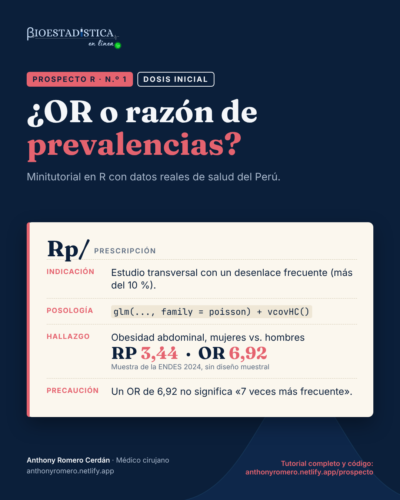

```{r}
#| label: configuracion
#| include: false
options(OutDec = ",")
knitr::opts_chunk$set(comment = "#>", fig.align = "center", results = "hold")
# cada resultado de R va en un bloque plegable «Mira el resultado»
knitr::knit_hooks$set(output = local({
  salida <- knitr::knit_hooks$get("output")
  function(x, options) paste0(
    '\n\n```{=html}\n<details class="salida" open><summary>Mira el resultado</summary>\n```\n\n',
    salida(x, options),
    '\n\n```{=html}\n</details>\n```\n\n')
}))
# formato de números para el texto: siempre con coma decimal
fmt <- function(x, d = 2) formatC(x, format = "f", digits = d, decimal.mark = ",", big.mark = " ")
pct <- function(x, d = 1) paste0(fmt(100 * x, d), " %")  # espacio que no se separa
```

{fig-alt="Receta del Prospecto R n.º 1, dosis inicial, con la indicación, la posología, el hallazgo y la precaución" width="440" fig-align="center"}

::: {.callout-note appearance="minimal"}
**Prospecto R** es una serie de minitutoriales de análisis de datos de salud en R. Cada entrega responde una pregunta concreta con datos reales del Perú, explica la teoría mínima necesaria y muestra el código completo con sus resultados. Las cifras de este texto se calculan al compilar el documento: no se escriben a mano.
:::

::: {.callout-tip}
## ¿Qué dosis te toca?

Cada tema de Prospecto R viene en dos niveles. La **dosis inicial** tiene lo indispensable para hacer el análisis e interpretarlo bien. La **dosis plena** tiene todo, incluido lo complejo. Responde:

1. ¿Has ajustado una regresión (logística o de Poisson) en R?
2. ¿Sabes para qué sirven los pesos, los conglomerados y los estratos de una encuesta?
3. ¿Unes dos bases de datos en R sin ayuda?

Si respondiste «sí» a las tres, sigue con la [dosis plena](plena.qmd). Si alguna fue «no», empieza por la [dosis inicial](inicial.qmd).
:::

::: {.callout-important appearance="simple" icon=false}
**Estás en la dosis inicial.** Aquí va lo indispensable: elegir la medida, calcularla e interpretarla. Para que el foco esté en eso, se analiza la **muestra** de la ENDES sin su diseño muestral; al final verás qué cambia cuando se incluye, y la [dosis plena](plena.qmd) lo desarrolla completo.
:::

| | |
|---|---|
| **Nivel** | Dosis inicial |
| **Pregunta** | ¿Qué medida de asociación reporto en un estudio transversal con un desenlace frecuente? |
| **Datos** | ENDES 2024, Cuestionario de Salud (INEI) |
| **Paquetes** | `data.table`, `epiR`, `sandwich`, `lmtest`, `ggplot2` |
| **Requisitos** | Saber abrir un archivo en R y qué es una prevalencia |

## Indicación

Estás analizando un [estudio transversal](../diccionario.qmd#estudio-transversal){.dic} con un desenlace **binario** (sí/no) y quieres cuantificar su asociación con una exposición. Si el desenlace es frecuente (como regla práctica, más del 10&nbsp;%), la medida que responde directamente a tu pregunta es la **[razón de prevalencias](../diccionario.qmd#razon-de-prevalencias){.dic} (RP)**, no el [odds ratio](../diccionario.qmd#odds-ratio){.dic} (OR).

## Composición

Todo parte de una [tabla 2×2](../diccionario.qmd#tabla-2x2){.dic}:

| | Con desenlace | Sin desenlace |
|---|---|---|
| **Expuestos** | $a$ | $b$ |
| **No expuestos** | $c$ | $d$ |

La [prevalencia](../diccionario.qmd#prevalencia){.dic} en expuestos es $P_1 = a/(a+b)$ y en no expuestos, $P_0 = c/(c+d)$. Con ellas:

$$
\text{RP} = \frac{P_1}{P_0}
\qquad\qquad
\text{OR} = \frac{a\,d}{b\,c}
$$

La RP se lee de forma directa: "la prevalencia en expuestos es *k* veces la de no expuestos". El OR compara **[odds](../diccionario.qmd#odds){.dic}** (chances: los que tienen el desenlace entre los que no lo tienen), una escala que casi nadie interpreta bien. Cuando el desenlace es raro, las dos cifras se parecen; cuando es frecuente, el OR se aleja de 1 mucho más que la RP:

```{r}
#| label: fig-teoria
#| fig-cap: "Para una misma razón de prevalencias, el OR crece a medida que el desenlace es más frecuente."
#| fig-width: 7
#| fig-height: 4
#| code-fold: true
#| code-summary: "Código de la figura"
library(ggplot2)
teoria <- expand.grid(p0 = seq(0.01, 0.30, by = 0.005), rp = c(1.5, 2, 3))
teoria$p1 <- teoria$p0 * teoria$rp
teoria$or <- with(teoria, (p1 / (1 - p1)) / (p0 / (1 - p0)))
ggplot(teoria, aes(p0, or, colour = factor(rp))) +
  geom_hline(aes(yintercept = rp, colour = factor(rp)), linetype = "dashed") +
  geom_line(linewidth = 1) +
  scale_x_continuous("Prevalencia en no expuestos (P0)",
                     labels = scales::label_percent(decimal.mark = ",", suffix = " %")) +
  scale_y_continuous("Odds ratio", labels = scales::label_number(decimal.mark = ",")) +
  scale_colour_manual("Razón de prevalencias", values = c("#4FC3C8", "#7FB2F0", "#E5636F")) +
  theme_minimal(base_size = 13) +
  theme(legend.position = "top")
```

Las líneas punteadas marcan la RP real. Con una RP de 3 y una prevalencia de 20&nbsp;% en no expuestos, el OR ya es `r fmt(with(subset(teoria, rp == 3 & abs(p0 - 0.20) < 1e-9), or), 1)`.

## Posología

La pregunta del ejemplo, con datos de la [ENDES](../diccionario.qmd#endes){.dic} 2024: **¿cuánto más frecuente es la [obesidad abdominal](../diccionario.qmd#obesidad-abdominal){.dic} en las mujeres que en los hombres?**

### Paso 1. Descarga los datos

En el portal de microdatos del INEI (<https://proyectos.inei.gob.pe/microdatos/>), elige *Consulta por encuestas*, luego ENDES y el año 2024, y descarga en formato CSV estos dos módulos:

| Módulo | Archivo | Contenido |
|---|---|---|
| 1640 | `CSALUD01_2024.csv` | Cuestionario de salud de personas de 15 y más años (incluye el perímetro de cintura) |
| 1632 | `RE223132_2024.csv` | Cuestionario individual de mujeres (incluye si está embarazada) |

Descomprime los dos archivos dentro de una carpeta `ENDES/2024/`, junto a tu archivo `.qmd`. Cada uno crea su propia subcarpeta; en la descarga de 2024 se llaman `968-Modulo1640` y `968-Modulo1632`. Si tus datos están en otro lugar o las carpetas tienen otro nombre, cambia `ruta` en el siguiente bloque de código.

### Paso 2. Prepara la base

La obesidad abdominal se define con el perímetro de cintura y los puntos de corte del ATP III: más de 102 cm en hombres y más de 88 cm en mujeres. Hay que excluir a las gestantes, porque en ellas el perímetro abdominal no mide grasa; ese dato está en el cuestionario de mujeres, así que se unen los dos módulos.

```{r}
#| label: preparacion
library(data.table)

ruta <- "ENDES/2024"   # carpeta con los módulos descomprimidos
if (!dir.exists(ruta)) stop("No encuentro la carpeta '", ruta, "'. Revisa el Paso 1 o cambia `ruta`.")

# 1. lee solo las columnas que se usan
salud <- fread(file.path(ruta, "968-Modulo1640/CSALUD01_2024.csv"), encoding = "UTF-8",
               select = c("HHID", "QS20C", "QSSEXO", "QS23", "QS907", "QS908", "PESO15_AMAS"))
mujer <- fread(file.path(ruta, "968-Modulo1632/RE223132_2024.csv"), encoding = "UTF-8",
               select = c("CASEID", "V213"))

# 2. une los módulos: la mujer se identifica por su hogar (HHID) y su número de línea
salud[, HHID := trimws(HHID)]
mujer[, `:=`(HHID  = trimws(substr(CASEID, 1, nchar(CASEID) - 3)),
             QS20C = as.integer(substr(CASEID, nchar(CASEID) - 1, nchar(CASEID))))]
d <- merge(salud, mujer[, .(HHID, QS20C, V213)], by = c("HHID", "QS20C"), all.x = TRUE)

# 3. crea las variables
d <- d[!is.na(PESO15_AMAS)]                                  # personas con entrevista de salud
d[, sexo := factor(QSSEXO, 1:2, c("Hombre", "Mujer"))]
d[, edad := cut(QS23, c(15, 30, 45, 60, Inf), right = FALSE,
                labels = c("15-29", "30-44", "45-59", "60+"))]
d[, gestante := !is.na(V213) & V213 == 1]                    # V213 = 1: embarazada ahora
d[, cintura := fifelse(QS908 == 1 & QS907 >= 55 & QS907 <= 170, as.numeric(QS907), NA_real_)]
d[gestante == TRUE, cintura := NA]
d[, obes_abd := as.integer(fifelse(sexo == "Mujer", cintura > 88, cintura > 102))]

# 4. quédate con quienes tienen la medición válida
dc <- d[!is.na(obes_abd)]
nrow(dc)
```

::: {.leer}
Es el número de personas que entran al análisis: `r fmt(nrow(dc), 0)`. De las `r fmt(nrow(d), 0)` con entrevista de salud, quedan fuera quienes no tienen una medición válida de la cintura y las `r fmt(sum(d$gestante), 0)` gestantes. Anota siempre esta cifra: es la *n* que reportarás.
:::

`QS908 = 1` indica que la cintura se midió; el rango de 55 a 170 cm descarta valores imposibles. Si quieres el detalle de cada variable, está en la [dosis plena](plena.qmd).

### Paso 3. Arma la tabla 2×2

```{r}
#| label: tabla
tab <- table(Sexo = relevel(dc$sexo, ref = "Mujer"),
             Obesidad = factor(dc$obes_abd, levels = c(1, 0), labels = c("Sí", "No")))
tab
```

::: {.leer}
- **Filas:** mujeres arriba (expuestas) y hombres abajo (no expuestos).
- **Columnas:** primero quienes tienen obesidad abdominal (`Sí`) y luego quienes no (`No`).
- Así, `r fmt(tab["Mujer", "Sí"], 0)` es la celda *a* (mujeres con obesidad abdominal) y `r fmt(tab["Hombre", "No"], 0)` es la *d* (hombres sin ella).
:::

El orden importa: los **expuestos** (mujeres) van en la primera fila y el desenlace **presente** en la primera columna. Así la tabla queda como la de la sección Composición. En el código, `c` y `d` se llaman `cc` y `dd` porque `c()` ya es una función de R y `d` es la base de datos.

### Paso 4. Calcula la RP y el OR a mano

```{r}
#| label: a-mano
a  <- tab["Mujer", "Sí"];  b  <- tab["Mujer", "No"]    # expuestas
cc <- tab["Hombre", "Sí"]; dd <- tab["Hombre", "No"]   # no expuestos
p1 <- a / (a + b)     # prevalencia en mujeres
p0 <- cc / (cc + dd)  # prevalencia en hombres
c(P1 = p1, P0 = p0, RP = p1 / p0, OR = (a * dd) / (b * cc))
```

::: {.leer}
- **`P1` y `P0`** son las prevalencias en proporción: `r fmt(p1, 4)` es `r pct(p1)` de mujeres con obesidad abdominal y `r fmt(p0, 4)`, `r pct(p0)` de hombres.
- **`RP`** = `r fmt(p1 / p0)`: la prevalencia en mujeres es `r fmt(p1 / p0)` veces la de los hombres.
- **`OR`** = `r fmt((a * dd) / (b * cc))`: el cociente de odds, casi el doble de la RP.
:::

### Paso 5. Obtén los intervalos de confianza con `epiR`

```{r}
#| label: epir
library(epiR)
res <- epi.2by2(tab, method = "cross.sectional")
# las dos medidas que interesan, redondeadas
cbind(res$massoc.summary[1:2, "var", drop = FALSE], round(res$massoc.summary[1:2, -1], 2))
```

```{r}
#| label: epir-texto
#| include: false
rp <- unlist(res$massoc.summary[res$massoc.summary$var == "Prev risk ratio", c("est", "lower", "upper")])
or <- unlist(res$massoc.summary[res$massoc.summary$var == "Prev odds ratio", c("est", "lower", "upper")])
```


::: {.leer}
- **`var`** dice qué medida es: con `method = "cross.sectional"`, `epiR` llama *Prev risk ratio* a la RP y *Prev odds ratio* al OR.
- **`est`** es la estimación; **`lower`** y **`upper`**, los límites del intervalo de confianza del 95&nbsp;%.
- Si el intervalo no incluye el 1, los datos no son compatibles con la ausencia de asociación. Aquí la RP va de `r fmt(rp[2])` a `r fmt(rp[3])`.
:::

Si escribes solo `res`, `epiR` imprime un informe completo en inglés: la tabla con las prevalencias de cada fila (*Prev risk*, por cada 100 personas) y otras medidas que no hacen falta para esta pregunta, como la fracción atribuible y el valor E. Ese informe mezcla coma y punto decimal; por eso aquí se extraen solo las dos filas que importan.

### Paso 6. Haz lo mismo con un modelo

La tabla 2×2 no permite ajustar por otras variables; un modelo sí. Para la RP se usa una **[regresión de Poisson](../diccionario.qmd#regresion-de-poisson){.dic} con [varianza robusta](../diccionario.qmd#varianza-robusta){.dic}**. El modelo de Poisson por sí solo da intervalos demasiado anchos con un desenlace binario; la varianza robusta lo corrige.

```{r}
#| label: poisson
library(sandwich)
library(lmtest)
m_rp <- glm(obes_abd ~ sexo, data = dc, family = poisson(link = "log"))
ic_rp <- coefci(m_rp, vcov. = vcovHC(m_rp, type = "HC0"))
exp(cbind(RP = coef(m_rp), ic_rp))["sexoMujer", ]
```

::: {.leer}
- **`RP`** es la razón de prevalencias y los otros dos números, su intervalo de confianza del 95&nbsp;%.
- Se toma la fila `sexoMujer`: el efecto de ser mujer frente a la categoría de referencia, el primer nivel del factor (`Hombre`).
- `exp()` convierte los coeficientes del modelo, que están en escala logarítmica, en razones.
:::

La RP del modelo es la misma de la tabla. Ahora ajusta por edad, que podría [confundir](../diccionario.qmd#confusion){.dic} la asociación:

```{r}
#| label: poisson-ajustado
m_rp_aj <- glm(obes_abd ~ sexo + edad, data = dc, family = poisson(link = "log"))
ic_aj <- coefci(m_rp_aj, vcov. = vcovHC(m_rp_aj, type = "HC0"))
rp_aj <- exp(cbind(RP = coef(m_rp_aj), ic_aj))["sexoMujer", ]
rp_aj
```

::: {.leer}
Se lee igual que el anterior, pero ahora la RP compara mujeres y hombres **de la misma edad**. Pasó de `r fmt(rp[1])` a `r fmt(rp_aj[1])`. `r if (abs(rp_aj[1] / rp[1] - 1) < 0.10) 'Cambió menos de 10 %, un criterio práctico habitual: la edad casi no confunde esta asociación.' else 'Cambió más de 10 %, un criterio práctico habitual: la edad confunde esta asociación y conviene reportar la RP ajustada.'`
:::

Si en cambio usaras la [regresión logística](../diccionario.qmd#regresion-logistica){.dic}, obtendrías el OR:

```{r}
#| label: logistica
m_or <- glm(obes_abd ~ sexo, data = dc, family = binomial)
exp(cbind(OR = coef(m_or), confint.default(m_or)))["sexoMujer", ]
```

::: {.leer}
El mismo formato, pero el primer número es un OR: `r fmt(or[1])`, igual al de `epiR`. No lo leas como "veces más frecuente".
:::

## Resultado

```{r}
#| label: resultado-texto
#| include: false
ic <- function(x) sprintf("%s (IC 95 %%: %s a %s)", fmt(x[1]), fmt(x[2]), fmt(x[3]))
```

| Medida | Estimación |
|---|---|
| Prevalencia en mujeres | `r pct(p1)` |
| Prevalencia en hombres | `r pct(p0)` |
| **Razón de prevalencias** | **`r ic(rp)`** |
| Razón de prevalencias ajustada por edad | `r ic(rp_aj)` |
| Odds ratio | `r ic(or)` |

La RP dice que, en la muestra, la obesidad abdominal es `r fmt(rp[1])` veces más frecuente en mujeres que en hombres. El OR, `r fmt(or[1])`, es `r fmt(or[1] / rp[1], 1)` veces la RP: si se leyera como "`r fmt(or[1], 0)` veces más frecuente", la asociación quedaría más que duplicada.

## Contraindicaciones y reacciones adversas

- **Leer el OR como una razón de prevalencias.** Es el error más frecuente. Un OR de `r fmt(or[1])` no significa "`r fmt(or[1], 0)` veces más frecuente".
- **Usar la regresión logística por costumbre.** En un estudio transversal con desenlace frecuente, usa la regresión de Poisson con varianza robusta.
- **Olvidar la varianza robusta.** Sin `vcovHC()`, el modelo de Poisson da la misma RP pero con intervalos demasiado anchos.
- **Desenlace raro.** Si la prevalencia es baja (menos de 10&nbsp;%), el OR y la RP casi coinciden y la logística es aceptable.

## Cómo reportarlo

> En la muestra de la ENDES 2024 (n = `r fmt(nrow(dc), 0)` personas de 15 y más años), la prevalencia de obesidad abdominal fue `r pct(p1)` en mujeres y `r pct(p0)` en hombres; la razón de prevalencias fue `r ic(rp)`, estimada con regresión de Poisson con varianza robusta.

Si tus datos vienen de un hospital o de una muestra simple, este análisis es el completo. Si vienen de una encuesta con diseño complejo, como la ENDES, sigue leyendo.

## Siguiente dosis

```{r}
#| label: plena
#| include: false
# cifras de la dosis plena (las escribe plena.qmd al compilarse)
if (!file.exists("receta_plena.json")) stop("Compila primero plena.qmd: crea receta_plena.json")
plena <- jsonlite::read_json("receta_plena.json")
```

::: {.callout-note}
## Lo que esta dosis dejó fuera

Las cifras de arriba describen a las personas **entrevistadas**, no a la población peruana. La ENDES es una muestra aleatoria, pero no simple: algunas zonas tienen en la muestra más peso del que tienen en la población, y los hogares se eligen agrupados en conglomerados. Para hablar de la población hay que usar su **[diseño muestral](../diccionario.qmd#diseno-muestral-complejo){.dic}** ([pesos](../diccionario.qmd#factor-de-expansion){.dic}, [conglomerados](../diccionario.qmd#conglomerado){.dic} y [estratos](../diccionario.qmd#estrato){.dic}). Con él, la prevalencia es `r plena$p_m` en mujeres y `r plena$p_h` en hombres, y la RP es `r plena$rp`, no `r fmt(rp[1])`.

La [dosis plena](plena.qmd) desarrolla todo eso:

- Cómo declarar el diseño muestral de la ENDES con el paquete `survey` y por qué cambia las cifras.
- Ajuste por confusión dentro del diseño (edad y área de residencia).
- Cómo obtener una RP desde una regresión logística (estandarización marginal).
- Por qué el modelo log-binomial suele fallar con desenlaces frecuentes.
- Una trampa de los datos de antropometría de la ENDES.
- Cómo comprobar el flujo reproduciendo una cifra oficial del INEI.
:::

## Referencias

1. Zou G. A modified Poisson regression approach to prospective studies with binary data. *Am J Epidemiol*. 2004;159(7):702-6.
2. Barros AJD, Hirakata VN. Alternatives for logistic regression in cross-sectional studies: an empirical comparison of models that directly estimate the prevalence ratio. *BMC Med Res Methodol*. 2003;3:21.
3. Expert Panel on Detection, Evaluation, and Treatment of High Blood Cholesterol in Adults. Executive summary of the third report of the National Cholesterol Education Program (NCEP) Adult Treatment Panel III. *JAMA*. 2001;285(19):2486-97.

## Reproducibilidad

```{r}
#| label: sesion
#| echo: false
cat(R.version.string, "\n")
for (p in c("data.table", "epiR", "sandwich", "lmtest", "ggplot2")) cat(p, as.character(packageVersion(p)), "\n")
```

```{r}
#| label: receta-datos
#| include: false
jsonlite::write_json(list(
  nivel = "inicial", n = "1", t1 = "¿OR o razón de", t2 = "prevalencias?",
  ind = "Estudio transversal con un desenlace frecuente (más del 10 %).",
  pos = "glm(..., family = poisson) + vcovHC()",
  hal = "Obesidad abdominal, mujeres vs. hombres",
  hal2 = "Muestra de la ENDES 2024, sin diseño muestral",
  rp = fmt(rp[1]), or = fmt(or[1]), or0 = fmt(or[1], 0), p_m = pct(p1), p_h = pct(p0),
  pre = sprintf("Un OR de %s no significa «%s veces más frecuente».", fmt(or[1]), fmt(or[1], 0))
), "receta_inicial.json", auto_unbox = TRUE)
```
