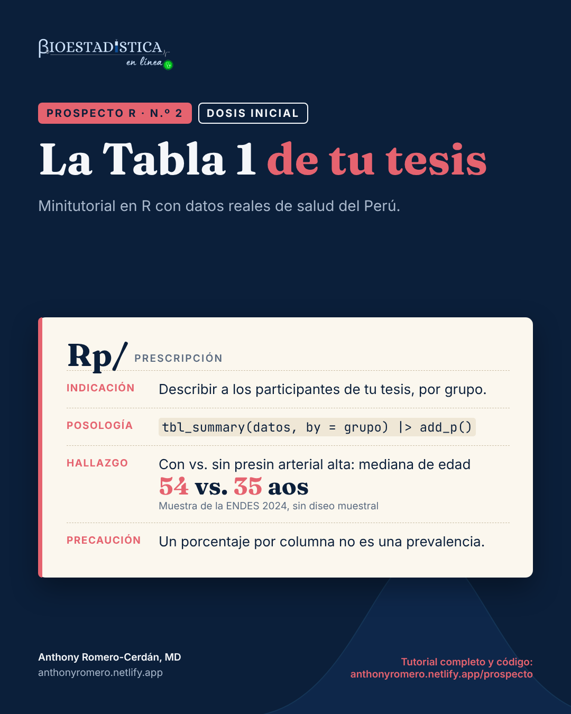

```{r}
#| label: configuracion
#| include: false
options(OutDec = ",")
knitr::opts_chunk$set(comment = "#>", fig.align = "center", results = "hold")
# cada resultado de R va en un bloque plegable «Mira el resultado»
knitr::knit_hooks$set(output = local({
  salida <- knitr::knit_hooks$get("output")
  function(x, options) paste0(
    '\n\n```{=html}\n<details class="salida" open><summary>Mira el resultado</summary>\n```\n\n',
    salida(x, options),
    '\n\n```{=html}\n</details>\n```\n\n')
}))
# formato de números para el texto: siempre con coma decimal
fmt <- function(x, d = 2) formatC(x, format = "f", digits = d, decimal.mark = ",", big.mark = " ")
pct <- function(x, d = 1) paste0(fmt(100 * x, d), " %")  # espacio que no se separa
```

{fig-alt="Receta del Prospecto R n.º 2, dosis inicial, con la indicación, la posología, el hallazgo y la precaución" width="440" fig-align="center"}

::: {.callout-note appearance="minimal"}
**Prospecto R** es una serie de minitutoriales de análisis de datos de salud en R. Cada entrega responde una pregunta concreta con datos reales del Perú, explica la teoría mínima necesaria y muestra el código completo con sus resultados. Las cifras de este texto se calculan al compilar el documento: no se escriben a mano.
:::

::: {.callout-tip}
## ¿Qué dosis te toca?

Cada tema de Prospecto R viene en dos niveles. La **dosis inicial** tiene lo indispensable para hacer el análisis e interpretarlo bien. La **dosis plena** tiene todo, incluido lo complejo. Responde:

1. ¿Has hecho una tabla descriptiva con gtsummary u otro paquete de R?
2. ¿Sabes para qué sirven los pesos, los conglomerados y los estratos de una encuesta?
3. ¿Sabes qué prueba estadística corresponde a cada tipo de variable?

Si respondiste «sí» a las tres, sigue con la [dosis plena](plena.qmd). Si alguna fue «no», empieza por la [dosis inicial](inicial.qmd).
:::

::: {.callout-important appearance="simple" icon=false}
**Estás en la dosis inicial.** Aquí va lo indispensable: armar la tabla, darle formato, leerla y llevarla a Word. Para que el foco esté en eso, se describe la **muestra** de la ENDES sin su diseño muestral; al final verás qué cambia cuando se incluye, y la [dosis plena](plena.qmd) lo desarrolla completo.
:::

| | |
|---|---|
| **Nivel** | Dosis inicial |
| **Pregunta** | ¿Cómo presento las características de mis participantes? |
| **Datos** | ENDES 2024, Cuestionarios de Salud y del Hogar (INEI) |
| **Paquetes** | `data.table`, `gtsummary`, `flextable` |
| **Requisitos** | Saber abrir un archivo en R y distinguir variables numéricas de categóricas |

::: {.descargas}
[Script .R de esta dosis](inicial.R){download="prospecto-r-02-inicial.R"}
[Ficha de una página (PDF)](ficha_inicial.pdf){download="prospecto-r-02-inicial.pdf"}
[Tabla 1 en Word](tabla1_inicial.docx){download="prospecto-r-02-tabla1-inicial.docx"}
:::

## Indicación

Casi toda tesis cuantitativa abre sus resultados con una tabla que describe a los participantes: la **Tabla 1**. Dice quiénes son (edad, sexo, nivel educativo…) y, casi siempre, cómo se reparten esas características según el desenlace o la exposición principal. Usa esta receta cuando necesites esa tabla lista para pegar en Word, sin copiar cifras a mano.

## Composición

En una Tabla 1, cada **fila** es una variable y cada **columna**, un grupo, con una columna adicional para el total. Lo que se escribe en cada celda depende del tipo de variable:

| Tipo de variable | Ejemplo | Resumen habitual |
|---|---|---|
| Numérica con distribución simétrica | presión arterial sistólica | media (desviación estándar) |
| Numérica asimétrica | edad, días de hospitalización | [mediana](../diccionario.qmd#mediana-y-ric){.dic} (rango intercuartílico) |
| Categórica | región, nivel educativo | n ([%](../diccionario.qmd#porcentaje-por-columna){.dic}) de cada categoría |
| Dicotómica (sí/no) | fuma | n (%) de los que responden «sí» |

Los porcentajes son **por columna**: dentro de cada grupo, qué parte tiene cada característica. Si la tabla compara grupos, suele llevar una columna con el [valor p](../diccionario.qmd#valor-p){.dic} de una prueba que contrasta la distribución de cada variable entre grupos.

## Posología

La pregunta del ejemplo, con datos de la [ENDES](../diccionario.qmd#endes){.dic} 2024: **¿en qué se diferencian las personas de 15 y más años con y sin presión arterial alta?** Se usa el mismo criterio que el INEI: promedio de dos mediciones de 140/90 mmHg o más, sin contar a las gestantes.

### Paso 1. Descarga los datos

En el portal de microdatos del INEI (<https://proyectos.inei.gob.pe/microdatos/>), elige *Consulta por encuestas*, luego ENDES y el año 2024, y descarga en formato CSV estos cuatro módulos:

| Módulo | Archivo | Contenido |
|---|---|---|
| 1640 | `CSALUD01_2024.csv` | Cuestionario de salud: presión arterial, tabaco, alcohol, diabetes |
| 1629 | `RECH0_2024.csv`, `RECH1_2024.csv` | Hogar (área de residencia) y sus miembros (nivel educativo) |
| 1630 | `RECH23_2024.csv` | Vivienda: región natural e índice de riqueza |
| 1632 | `RE223132_2024.csv` | Cuestionario de mujeres: embarazo actual |

Descomprime los cuatro archivos dentro de una carpeta `ENDES/2024/`, junto a tu archivo `.qmd`. Cada uno crea su propia subcarpeta (en 2024: `968-Modulo1629`, `968-Modulo1630`, `968-Modulo1632` y `968-Modulo1640`). Si tus datos están en otro lugar, cambia `ruta` en el siguiente bloque de código.

### Paso 2. Prepara la base

Este bloque une los módulos y crea una variable por cada fila de la tabla. Las respuestas «no sabe» (código 8) se tratan como dato faltante.

```{r}
#| label: preparacion
library(data.table)

ruta <- "ENDES/2024"   # carpeta con los módulos descomprimidos
if (!dir.exists(ruta)) stop("No encuentro la carpeta '", ruta, "'. Revisa el Paso 1 o cambia `ruta`.")

# 1. lee solo las columnas que se usan
salud <- fread(file.path(ruta, "968-Modulo1640/CSALUD01_2024.csv"), encoding = "UTF-8",
               select = c("HHID", "QS20C", "QSSEXO", "QS23", "QS109", "QS200", "QS201",
                          "QS206", "QS208", "QS210", "QS903S", "QS903D", "QS905S",
                          "QS905D", "QS906", "PESO15_AMAS"))
hogar <- fread(file.path(ruta, "968-Modulo1629/RECH0_2024.csv"),
               select = c("HHID", "HV001", "HV022", "HV025"))
miembros <- fread(file.path(ruta, "968-Modulo1629/RECH1_2024.csv"),
                  select = c("HHID", "HVIDX", "HV106"))
vivienda <- fread(file.path(ruta, "968-Modulo1630/RECH23_2024.csv"),
                  select = c("HHID", "SHREGION", "HV270"))
mujer <- fread(file.path(ruta, "968-Modulo1632/RE223132_2024.csv"), encoding = "UTF-8",
               select = c("CASEID", "V213"))

# 2. une los módulos: el hogar por HHID; la persona por HHID + número de línea
for (x in list(salud, hogar, miembros, vivienda)) x[, HHID := trimws(HHID)]
mujer[, `:=`(HHID  = trimws(substr(CASEID, 1, nchar(CASEID) - 3)),
             QS20C = as.integer(substr(CASEID, nchar(CASEID) - 1, nchar(CASEID))))]
d <- merge(salud, hogar, by = "HHID")
d <- merge(d, vivienda, by = "HHID", all.x = TRUE)
d <- merge(d, miembros, by.x = c("HHID", "QS20C"), by.y = c("HHID", "HVIDX"), all.x = TRUE)
d <- merge(d, mujer[, .(HHID, QS20C, V213)], by = c("HHID", "QS20C"), all.x = TRUE)
d <- d[!is.na(PESO15_AMAS)]                     # personas con entrevista de salud

# 3. desenlace: presión arterial alta según el promedio de dos mediciones
d[, pas := (QS903S + QS905S) / 2][, pad := (QS903D + QS905D) / 2]
d[QS906 != 1 | is.na(QS906) | QS903S >= 999 | QS905S >= 999 |
    QS903D >= 999 | QS905D >= 999, c("pas", "pad") := NA]
d[, pa_alta := factor(as.integer(pas >= 140 | pad >= 90), levels = 0:1,
                      labels = c("Sin presión arterial alta", "Con presión arterial alta"))]
d[, gestante := !is.na(V213) & V213 == 1]

# 4. características de los participantes
d[, edad       := QS23]
d[, grupo_edad := cut(QS23, c(15, 30, 45, 60, Inf), right = FALSE,
                      labels = c("15 a 29", "30 a 44", "45 a 59", "60 a más"))]
d[, sexo       := factor(QSSEXO, 1:2, c("Hombre", "Mujer"))]
d[, area       := factor(HV025, 1:2, c("Urbana", "Rural"))]
d[, region     := factor(SHREGION, 1:4, c("Lima Metropolitana", "Resto de la Costa", "Sierra", "Selva"))]
d[, educacion  := factor(fifelse(HV106 == 8, NA_integer_, HV106), 0:3,
                         c("Sin nivel o inicial", "Primaria", "Secundaria", "Superior"))]
d[, riqueza    := factor(HV270, 1:5, c("Quintil 1 (más pobre)", "Quintil 2", "Quintil 3",
                                       "Quintil 4", "Quintil 5 (más rico)"))]
d[, fuma       := fcase(QS200 == 2, FALSE, QS200 == 1 & QS201 == 1, TRUE,
                        QS200 == 1 & QS201 == 2, FALSE, default = NA)]
d[, alcohol    := fcase(QS206 == 2 | QS208 == 2, FALSE, QS210 == 1, TRUE,
                        QS210 == 2, FALSE, default = NA)]
d[, diabetes   := fcase(QS109 == 1, TRUE, QS109 == 2, FALSE, default = NA)]

# 5. participantes: presión arterial medida y no gestantes (criterio del INEI)
participantes <- d[!is.na(pa_alta) & !gestante]
nrow(participantes)
```

::: {.leer}
Es el número de personas que entran a la tabla: `r fmt(nrow(participantes), 0)`, de las cuales `r fmt(sum(participantes$pa_alta == "Con presión arterial alta"), 0)` tienen presión arterial alta. Es la *n* que reportarás en el título de la tabla.
:::

### Paso 3. Tu primera tabla

Con `tbl_summary()` basta una línea. El argumento `by` define las columnas; el resto de variables, las filas. Antes, `theme_gtsummary_language()` pone la tabla en español y con coma decimal.

```{r}
#| label: tabla-cruda
library(gtsummary)
theme_gtsummary_language("es", decimal.mark = ",", big.mark = " ")

variables <- c("edad", "grupo_edad", "sexo", "area", "region", "educacion",
               "riqueza", "fuma", "alcohol", "diabetes")
tabla <- participantes[, c(variables, "pa_alta"), with = FALSE]

tbl_summary(tabla, by = pa_alta)
```

::: {.leer}
- Cada **fila** es una variable; las de varias categorías se abren en subfilas.
- La **edad** sale como mediana (Q1 – Q3): gtsummary la detecta como numérica.
- Las variables sí/no (**fuma**, **alcohol**, **diabetes**) muestran una sola fila: n (%) de quienes responden «sí».
- **Desconocido** cuenta los datos faltantes de esa variable; no entran al denominador del porcentaje.
- Las filas llevan el nombre de la columna en R (`grupo_edad`, `area`…): falta darle formato.
:::

### Paso 4. Dale formato de tesis

```{r}
#| label: tabla-final
tabla_1 <- tbl_summary(
  tabla,
  by = pa_alta,
  label = list(
    edad ~ "Edad (años)", grupo_edad ~ "Grupo de edad", sexo ~ "Sexo",
    area ~ "Área de residencia", region ~ "Región natural",
    educacion ~ "Nivel educativo", riqueza ~ "Índice de riqueza",
    fuma ~ "Fuma actualmente", alcohol ~ "Consumió alcohol en los últimos 30 días",
    diabetes ~ "Diabetes diagnosticada"
  ),
  statistic = list(all_categorical() ~ "{n} ({p} %)"),
  digits = list(all_categorical() ~ c(0, 1)),
  missing_text = "Sin dato"
) |>
  add_overall(last = FALSE) |>
  add_p() |>
  modify_header(label ~ "**Característica**") |>
  modify_footnote_header("Mediana (Q1 – Q3); n (%)", columns = all_stat_cols()) |>
  bold_labels()
tabla_1
```

```{r}
#| label: celda-texto
#| include: false
con_pa <- participantes[pa_alta == "Con presión arterial alta"]
celda_hombres <- sprintf("%s (%s)", fmt(sum(con_pa$sexo == "Hombre"), 0), pct(mean(con_pa$sexo == "Hombre")))
```

::: {.leer}
- **`label`** reemplaza los nombres de las columnas por textos para el lector.
- **`statistic`** y **`digits`** fijan el formato de las categóricas: n y porcentaje con un decimal.
- **`add_overall()`** agrega la columna del total; **`add_p()`**, el valor p de cada variable.
- Las **notas al pie** dicen qué resumen se usó y qué prueba dio cada valor p: suma de rangos de Wilcoxon para la edad y [chi cuadrado de Pearson](../diccionario.qmd#prueba-de-chi-cuadrado){.dic} para las categóricas. Esas pruebas van también en tu sección de métodos.
- Cómo leer una celda: en la columna de quienes tienen presión arterial alta, la fila *Hombre* dice `r celda_hombres`: ese número de hombres y su porcentaje **dentro de ese grupo**.
:::

### Paso 5. Llévala a Word

```{r}
#| label: word
as_flex_table(tabla_1) |>
  flextable::save_as_docx(path = "tabla1_inicial.docx")
```

`as_flex_table()` convierte la tabla al formato de `flextable`, que se guarda como documento de Word con las notas al pie. Aquí puedes descargar el resultado: [Tabla 1 en Word](tabla1_inicial.docx){download="prospecto-r-02-tabla1-inicial.docx"}.

## Resultado

```{r}
#| label: resultado-texto
#| include: false
grupo <- function(g) participantes[pa_alta == g]
con <- grupo("Con presión arterial alta"); sin <- grupo("Sin presión arterial alta")
med <- function(x) fmt(median(x), 0)
prop <- function(x) pct(mean(x, na.rm = TRUE))
```

Frente a quienes no la tienen, las personas con presión arterial alta de la muestra:

- son mayores: mediana de `r med(con$edad)` frente a `r med(sin$edad)` años;
- son con más frecuencia hombres: `r prop(con$sexo == "Hombre")` frente a `r prop(sin$sexo == "Hombre")`;
- tienen con más frecuencia diabetes diagnosticada: `r prop(con$diabetes)` frente a `r prop(sin$diabetes)`.

## Contraindicaciones y reacciones adversas

- **Valores p en un ensayo aleatorizado.** Si los grupos se formaron al azar, las diferencias basales son azar por definición; CONSORT recomienda no ponerlos en la Tabla 1.
- **Callar qué prueba se usó.** gtsummary la indica en la nota al pie: cópiala en métodos.
- **Media y desviación estándar para variables muy asimétricas.** Usa mediana y rango intercuartílico, como hace gtsummary por defecto.
- **Ocultar los datos faltantes.** Si una variable tiene datos sin registrar, muéstralos (fila *Sin dato*): el lector necesita saber sobre cuántas personas se calculó cada porcentaje.
- **Leer el porcentaje por columna como prevalencia.** Que el `r prop(con$sexo == "Hombre")` de quienes tienen presión alta sean hombres no significa que ese porcentaje de los hombres tenga presión alta. Esa otra lectura, por fila, está en la [dosis plena](plena.qmd).

## Cómo reportarlo

::: {.reporte}
> Se analizaron `r fmt(nrow(participantes), 0)` personas de 15 y más años de la ENDES 2024 con medición de presión arterial, de las cuales `r fmt(nrow(con), 0)` (`r pct(nrow(con) / nrow(participantes))`) tenían presión arterial alta. Frente a quienes no la tenían, eran mayores (mediana de edad de `r med(con$edad)` frente a `r med(sin$edad)` años) y con más frecuencia hombres (`r prop(con$sexo == "Hombre")` frente a `r prop(sin$sexo == "Hombre")`) (Tabla 1).
:::

En métodos, describe cómo resumiste cada tipo de variable y qué pruebas usaste: «Las variables numéricas se resumieron con mediana y rango intercuartílico y se compararon con la prueba de suma de rangos de Wilcoxon; las categóricas, con frecuencias y porcentajes, y la prueba de chi cuadrado de Pearson».

## Autoevaluación

::: {.autoeval}
::: {.pregunta}
**1.** En tu tabla, la edad tiene una distribución muy asimétrica. ¿Qué resumen pones: media (DE) o mediana (RIC)?

<details><summary>Ver respuesta</summary>

Mediana y rango intercuartílico. La media se arrastra hacia los valores extremos; la mediana describe mejor al participante típico.

</details>
:::

::: {.pregunta}
**2.** Tu tesis es un ensayo clínico aleatorizado. ¿Agregas `add_p()` a la Tabla 1?

<details><summary>Ver respuesta</summary>

No. Con asignación al azar, cualquier diferencia basal es azar por definición y el valor p no aporta. Describe los grupos y, si una diferencia es grande, coméntala por su magnitud.

</details>
:::

::: {.pregunta}
**3.** Una celda dice «`r celda_hombres`» en la columna *Con presión arterial alta*, fila *Hombre*. ¿Qué significa ese 59,3 %?

<details><summary>Ver respuesta</summary>

Que de cada 100 personas con presión arterial alta en la muestra, unas `r fmt(100 * mean(con_pa$sexo == "Hombre"), 0)` son hombres. **No** es el porcentaje de hombres que tiene presión alta.

</details>
:::
:::

## Siguiente dosis

```{r}
#| label: plena
#| include: false
if (!file.exists("receta_plena.json")) stop("Compila primero plena.qmd: crea receta_plena.json")
plena <- jsonlite::read_json("receta_plena.json")
```

::: {.callout-note}
## Lo que esta dosis dejó fuera

Esta tabla describe a las personas **entrevistadas**. La ENDES da a algunas zonas más peso en la muestra que en la población: en la muestra, el `r prop(participantes$area == "Rural")` vive en zona rural; en la población, con los pesos de la encuesta, es el `r plena$rural_pob`. Para hablar de la población hay que usar el **diseño muestral**.

La [dosis plena](plena.qmd) desarrolla todo eso:

- La Tabla 1 con el diseño de la encuesta: `tbl_svysummary()`.
- Qué *n* reportar cuando los porcentajes están ponderados.
- La tabla por filas: qué porcentaje de cada grupo tiene presión arterial alta, con su intervalo de confianza.
- Qué pruebas usa gtsummary con datos de encuesta.
- Cómo comprobar la tabla con una cifra oficial del INEI.
:::

::: {.cta}
**¿Tienes que armar las tablas de tu tesis?**

Te ayudo a ordenar las variables, correr el análisis en R y redactar los resultados.

[Escríbeme]()
:::

## Referencias

1. Sjoberg DD, Whiting K, Curry M, Lavery JA, Larmarange J. Reproducible summary tables with the gtsummary package. *The R Journal*. 2021;13(1):570-80.
2. von Elm E, Altman DG, Egger M, Pocock SJ, Gøtzsche PC, Vandenbroucke JP. The Strengthening the Reporting of Observational Studies in Epidemiology (STROBE) statement: guidelines for reporting observational studies. *Lancet*. 2007;370(9596):1453-7.
3. Schulz KF, Altman DG, Moher D, CONSORT Group. CONSORT 2010 statement: updated guidelines for reporting parallel group randomised trials. *BMJ*. 2010;340:c332.

## Reproducibilidad

```{r}
#| label: sesion
#| echo: false
cat(R.version.string, "\n")
for (p in c("data.table", "gtsummary", "flextable")) cat(p, as.character(packageVersion(p)), "\n")
```

```{r}
#| label: receta-datos
#| include: false
jsonlite::write_json(list(
  nivel = "inicial", n = "2", t1 = "La Tabla 1", t2 = "de tu tesis",
  ind = "Describir a los participantes de tu tesis, por grupo.",
  pos = "tbl_summary(datos, by = grupo) |> add_p()",
  hal = "Con vs. sin presión arterial alta: mediana de edad",
  big = sprintf("<b>%s</b> vs. <b>%s</b> años", med(con$edad), med(sin$edad)),
  hal2 = "Muestra de la ENDES 2024, sin diseño muestral",
  pre = "Un porcentaje por columna no es una prevalencia.",
  ficha = list(
    usar = c("Al inicio de los resultados de tu tesis: quiénes son los participantes.",
             "Para comparar sus características entre grupos (desenlace o exposición).",
             "Datos sin diseño muestral complejo (hospital, muestra simple)."),
    codigo = paste(c(
      'library(gtsummary)',
      'theme_gtsummary_language("es", decimal.mark = ",")',
      'tabla_1 <- tbl_summary(datos, by = grupo,',
      '                       label = list(edad ~ "Edad (años)"),',
      '                       missing_text = "Sin dato") |>',
      '  add_overall() |> add_p() |> bold_labels()',
      'as_flex_table(tabla_1) |> flextable::save_as_docx(path = "tabla1.docx")'), collapse = "\n"),
    leer = c("Numéricas: mediana (Q1 – Q3); categóricas: n (%) dentro de cada columna.",
             "Variables sí/no: una sola fila con quienes responden «sí».",
             "La nota al pie dice qué prueba dio cada valor p: cópiala en métodos."),
    hallazgo = sprintf("ENDES 2024 (muestra, n = %s): con presión arterial alta, mediana de edad %s frente a %s años; hombres %s frente a %s.",
                       fmt(nrow(participantes), 0), med(con$edad), med(sin$edad),
                       prop(con$sexo == "Hombre"), prop(sin$sexo == "Hombre")),
    reporte = sprintf("Se analizaron %s personas de 15 y más años de la ENDES 2024 con medición de presión arterial, de las cuales %s (%s) tenían presión arterial alta (Tabla 1).",
                      fmt(nrow(participantes), 0), fmt(nrow(con), 0), pct(nrow(con) / nrow(participantes))),
    evitar = c("Valores p en la Tabla 1 de un ensayo aleatorizado.",
               "Media y DE para variables muy asimétricas.",
               "Ocultar los datos faltantes.",
               "Leer un porcentaje por columna como prevalencia.")
  )
), "receta_inicial.json", auto_unbox = TRUE)
```

```{r}
#| label: script-r
#| include: false
# script .R descargable: todo el código de la página, en orden, listo para correr
escribir_script <- function(qmd, salida, titulo) {
  x <- readLines(qmd, encoding = "UTF-8")
  omitir <- c("configuracion", "receta-datos", "script-r", "sesion", "plena", "celda-texto")
  out <- c(paste("#", titulo),
           "# Prospecto R · Anthony Romero Cerdán · anthonyromero.netlify.app/prospecto",
           "# Datos: ENDES 2024 (INEI). Descárgalos como indica el Paso 1 del tutorial.",
           "",
           "options(OutDec = \",\")",
           "fmt <- function(x, d = 2) formatC(x, format = \"f\", digits = d, decimal.mark = \",\", big.mark = \"\\u00a0\")",
           "pct <- function(x, d = 1) paste0(fmt(100 * x, d), \"\\u00a0%\")")
  inicios <- grep("^```\\{r", x)
  for (i in inicios) {
    fin <- i + which(x[(i + 1):length(x)] == "```")[1]
    cuerpo <- x[(i + 1):(fin - 1)]
    opciones <- grep("^#\\|", cuerpo, value = TRUE)
    etiqueta <- sub("^#\\| label: *", "", grep("^#\\| label:", opciones, value = TRUE))
    if (length(etiqueta) && etiqueta %in% omitir) next
    nota <- if (any(grepl("include: false", opciones))) " (cifras auxiliares para el texto)" else ""
    out <- c(out, "", paste0("# ---- ", etiqueta, nota, " ----"), cuerpo[!grepl("^#\\|", cuerpo)])
  }
  writeLines(enc2utf8(out), salida, useBytes = TRUE)
}
escribir_script(knitr::current_input(), "inicial.R", "La Tabla 1 de tu tesis · Prospecto R n.º 2 · dosis inicial")
```
