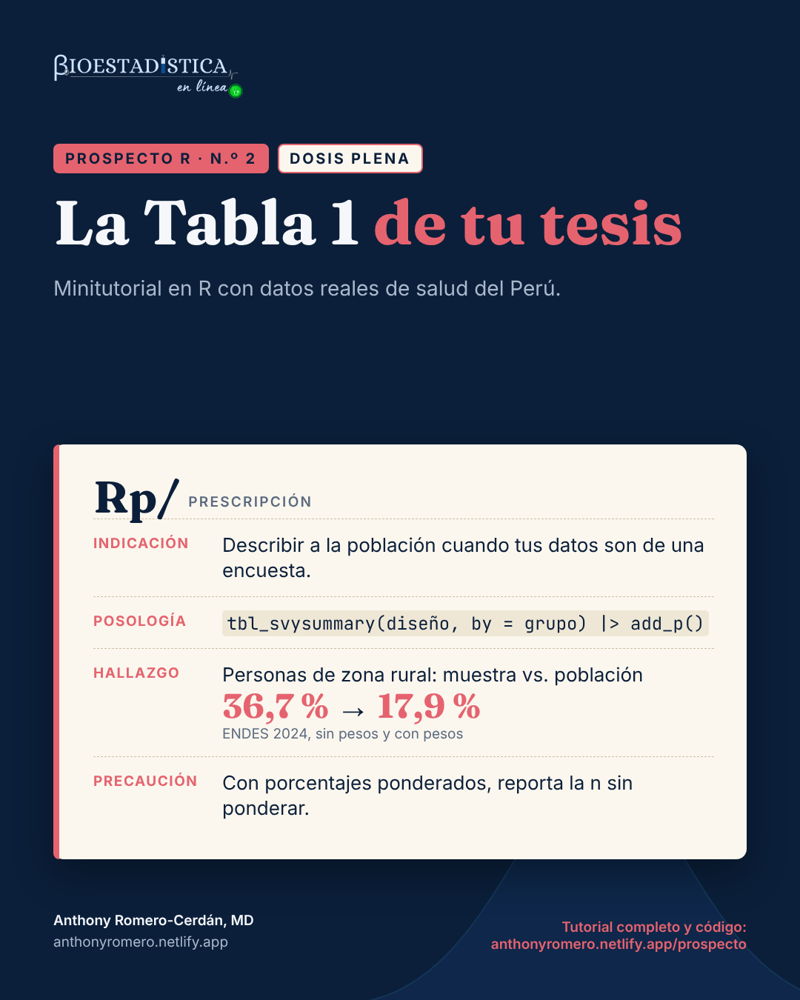

```{r}
#| label: configuracion
#| include: false
options(OutDec = ",")
knitr::opts_chunk$set(comment = "#>", fig.align = "center", results = "hold")
# cada resultado de R va en un bloque plegable «Mira el resultado»
knitr::knit_hooks$set(output = local({
  salida <- knitr::knit_hooks$get("output")
  function(x, options) paste0(
    '\n\n```{=html}\n<details class="salida" open><summary>Mira el resultado</summary>\n```\n\n',
    salida(x, options),
    '\n\n```{=html}\n</details>\n```\n\n')
}))
# formato de números para el texto: siempre con coma decimal
fmt <- function(x, d = 2) formatC(x, format = "f", digits = d, decimal.mark = ",", big.mark = " ")
pct <- function(x, d = 1) paste0(fmt(100 * x, d), " %")  # espacio que no se separa
```

{fig-alt="Receta del Prospecto R n.º 2, dosis plena, con la indicación, la posología, el hallazgo y la precaución" width="440" fig-align="center"}

::: {.callout-note appearance="minimal"}
**Prospecto R** es una serie de minitutoriales de análisis de datos de salud en R. Cada entrega responde una pregunta concreta con datos reales del Perú, explica la teoría mínima necesaria y muestra el código completo con sus resultados. Las cifras de este texto se calculan al compilar el documento: no se escriben a mano.
:::

::: {.callout-tip}
## ¿Qué dosis te toca?

Cada tema de Prospecto R viene en dos niveles. La **dosis inicial** tiene lo indispensable para hacer el análisis e interpretarlo bien. La **dosis plena** tiene todo, incluido lo complejo. Responde:

1. ¿Has hecho una tabla descriptiva con gtsummary u otro paquete de R?
2. ¿Sabes para qué sirven los pesos, los conglomerados y los estratos de una encuesta?
3. ¿Sabes qué prueba estadística corresponde a cada tipo de variable?

Si respondiste «sí» a las tres, sigue con la [dosis plena](plena.qmd). Si alguna fue «no», empieza por la [dosis inicial](inicial.qmd).
:::

::: {.callout-important appearance="simple" icon=false}
**Estás en la dosis plena.** Aquí va todo: la Tabla 1 con el diseño muestral, qué *n* reportar, la tabla de prevalencias con sus intervalos, las pruebas para encuestas y la comprobación con el INEI. Si es tu primera Tabla 1, empieza por la [dosis inicial](inicial.qmd).
:::

| | |
|---|---|
| **Nivel** | Dosis plena |
| **Pregunta** | ¿Cómo presento las características de la población cuando mis datos son de una encuesta? |
| **Datos** | ENDES 2024, Cuestionarios de Salud y del Hogar (INEI) |
| **Paquetes** | `data.table`, `survey`, `gtsummary`, `gt`, `flextable` |
| **Requisitos** | Haber hecho una Tabla 1 en R y conocer los pesos, conglomerados y estratos de una encuesta |

::: {.descargas}
[Script .R de esta dosis](plena.R){download="prospecto-r-02-plena.R"}
[Ficha de una página (PDF)](ficha_plena.pdf){download="prospecto-r-02-plena.pdf"}
[Tablas en Word](tabla1_plena.docx){download="prospecto-r-02-tabla1-plena.docx"}
:::

## Indicación

Casi toda tesis cuantitativa abre sus resultados con una tabla que describe a los participantes: la **Tabla 1**. Usa esta receta cuando tus datos vienen de una encuesta con [diseño muestral complejo](../diccionario.qmd#diseno-muestral-complejo){.dic} (ENDES, ENAHO, ENAPRES) y la tabla tiene que describir a la **población**, no solo a las personas entrevistadas.

## Composición

En una Tabla 1, cada **fila** es una variable y cada **columna**, un grupo, con una columna adicional para el total. Lo que va en cada celda depende del tipo de variable:

| Tipo de variable | Ejemplo | Resumen habitual |
|---|---|---|
| Numérica con distribución simétrica | presión arterial sistólica | media (desviación estándar) |
| Numérica asimétrica | edad, días de hospitalización | [mediana](../diccionario.qmd#mediana-y-ric){.dic} (rango intercuartílico) |
| Categórica | región, nivel educativo | n ([%](../diccionario.qmd#porcentaje-por-columna){.dic}) de cada categoría |
| Dicotómica (sí/no) | fuma | n (%) de los que responden «sí» |

Con datos de encuesta cambian tres cosas:

1. Los porcentajes y las medianas se calculan con los [pesos](../diccionario.qmd#factor-de-expansion){.dic}: describen a la población.
2. La *n* que se reporta es la de personas entrevistadas, **sin ponderar**. La suma de los pesos no es un número de personas.
3. Las pruebas que dan el [valor p](../diccionario.qmd#valor-p){.dic} tienen que considerar los [conglomerados](../diccionario.qmd#conglomerado){.dic} y [estratos](../diccionario.qmd#estrato){.dic}: por ejemplo, el chi cuadrado con la [corrección de Rao-Scott](../diccionario.qmd#prueba-de-chi-cuadrado){.dic}.

## Posología

La pregunta del ejemplo, con datos de la [ENDES](../diccionario.qmd#endes){.dic} 2024: **¿en qué se diferencian las personas de 15 y más años con y sin presión arterial alta?** Se usa el mismo criterio que el INEI: promedio de dos mediciones de 140/90 mmHg o más, sin contar a las gestantes.

### Paso 1. Descarga los datos

En el portal de microdatos del INEI (<https://proyectos.inei.gob.pe/microdatos/>), elige *Consulta por encuestas*, luego ENDES y el año 2024, y descarga en formato CSV estos cuatro módulos:

| Módulo | Archivo | Contenido |
|---|---|---|
| 1640 | `CSALUD01_2024.csv` | Cuestionario de salud: presión arterial, tabaco, alcohol, diabetes y factor de expansión |
| 1629 | `RECH0_2024.csv`, `RECH1_2024.csv` | Hogar (conglomerado, estrato, área) y sus miembros (nivel educativo) |
| 1630 | `RECH23_2024.csv` | Vivienda: región natural e índice de riqueza |
| 1632 | `RE223132_2024.csv` | Cuestionario de mujeres: embarazo actual |

Descomprime los cuatro archivos dentro de una carpeta `ENDES/2024/`, junto a tu archivo `.qmd`. Cada uno crea su propia subcarpeta (en 2024: `968-Modulo1629`, `968-Modulo1630`, `968-Modulo1632` y `968-Modulo1640`). Si tus datos están en otro lugar, cambia `ruta` en el siguiente bloque de código.

### Paso 2. Prepara la base

Este bloque une los módulos y crea una variable por cada fila de la tabla. Las respuestas «no sabe» (código 8) se tratan como dato faltante. Las preguntas que se saltan por el flujo del cuestionario se completan con su valor lógico: quien no fumó en el último año no fumó en el último mes.

```{r}
#| label: preparacion
library(data.table)

ruta <- "ENDES/2024"   # carpeta con los módulos descomprimidos
if (!dir.exists(ruta)) stop("No encuentro la carpeta '", ruta, "'. Revisa el Paso 1 o cambia `ruta`.")

# 1. lee solo las columnas que se usan
salud <- fread(file.path(ruta, "968-Modulo1640/CSALUD01_2024.csv"), encoding = "UTF-8",
               select = c("HHID", "QS20C", "QSSEXO", "QS23", "QS109", "QS200", "QS201",
                          "QS206", "QS208", "QS210", "QS903S", "QS903D", "QS905S",
                          "QS905D", "QS906", "PESO15_AMAS"))
hogar <- fread(file.path(ruta, "968-Modulo1629/RECH0_2024.csv"),
               select = c("HHID", "HV001", "HV022", "HV025"))
miembros <- fread(file.path(ruta, "968-Modulo1629/RECH1_2024.csv"),
                  select = c("HHID", "HVIDX", "HV106"))
vivienda <- fread(file.path(ruta, "968-Modulo1630/RECH23_2024.csv"),
                  select = c("HHID", "SHREGION", "HV270"))
mujer <- fread(file.path(ruta, "968-Modulo1632/RE223132_2024.csv"), encoding = "UTF-8",
               select = c("CASEID", "V213"))

# 2. une los módulos: el hogar por HHID; la persona por HHID + número de línea
for (x in list(salud, hogar, miembros, vivienda)) x[, HHID := trimws(HHID)]
mujer[, `:=`(HHID  = trimws(substr(CASEID, 1, nchar(CASEID) - 3)),
             QS20C = as.integer(substr(CASEID, nchar(CASEID) - 1, nchar(CASEID))))]
d <- merge(salud, hogar, by = "HHID")
d <- merge(d, vivienda, by = "HHID", all.x = TRUE)
d <- merge(d, miembros, by.x = c("HHID", "QS20C"), by.y = c("HHID", "HVIDX"), all.x = TRUE)
d <- merge(d, mujer[, .(HHID, QS20C, V213)], by = c("HHID", "QS20C"), all.x = TRUE)
d <- d[!is.na(PESO15_AMAS)]                     # personas con entrevista de salud

# 3. desenlace: presión arterial alta según el promedio de dos mediciones
d[, pas := (QS903S + QS905S) / 2][, pad := (QS903D + QS905D) / 2]
d[QS906 != 1 | is.na(QS906) | QS903S >= 999 | QS905S >= 999 |
    QS903D >= 999 | QS905D >= 999, c("pas", "pad") := NA]
d[, pa_alta := factor(as.integer(pas >= 140 | pad >= 90), levels = 0:1,
                      labels = c("Sin presión arterial alta", "Con presión arterial alta"))]
d[, gestante := !is.na(V213) & V213 == 1]

# 4. características de los participantes
d[, edad       := QS23]
d[, grupo_edad := cut(QS23, c(15, 30, 45, 60, Inf), right = FALSE,
                      labels = c("15 a 29", "30 a 44", "45 a 59", "60 a más"))]
d[, sexo       := factor(QSSEXO, 1:2, c("Hombre", "Mujer"))]
d[, area       := factor(HV025, 1:2, c("Urbana", "Rural"))]
d[, region     := factor(SHREGION, 1:4, c("Lima Metropolitana", "Resto de la Costa", "Sierra", "Selva"))]
d[, educacion  := factor(fifelse(HV106 == 8, NA_integer_, HV106), 0:3,
                         c("Sin nivel o inicial", "Primaria", "Secundaria", "Superior"))]
d[, riqueza    := factor(HV270, 1:5, c("Quintil 1 (más pobre)", "Quintil 2", "Quintil 3",
                                       "Quintil 4", "Quintil 5 (más rico)"))]
d[, fuma       := fcase(QS200 == 2, FALSE, QS200 == 1 & QS201 == 1, TRUE,
                        QS200 == 1 & QS201 == 2, FALSE, default = NA)]
d[, alcohol    := fcase(QS206 == 2 | QS208 == 2, FALSE, QS210 == 1, TRUE,
                        QS210 == 2, FALSE, default = NA)]
d[, diabetes   := fcase(QS109 == 1, TRUE, QS109 == 2, FALSE, default = NA)]

# 5. participantes: presión arterial medida y no gestantes (criterio del INEI)
participantes <- d[!is.na(pa_alta) & !gestante]
nrow(participantes)
```

::: {.leer}
Son las personas entrevistadas que entran a la tabla: `r fmt(nrow(participantes), 0)`. Esta es la *n* que se reporta; los porcentajes, en cambio, saldrán ponderados.
:::

### Paso 3. Declara el diseño muestral

```{r}
#| label: diseno
library(survey)
options(survey.lonely.psu = "adjust")

d[, peso := PESO15_AMAS / 1e6]                  # el factor viene con 6 decimales implícitos
diseno <- svydesign(ids = ~HV001, strata = ~HV022, weights = ~peso, data = d, nest = TRUE)
dis_part <- subset(diseno, !is.na(pa_alta) & !gestante)
```

`HV001` es el conglomerado, `HV022` el estrato y `peso` el factor de expansión del Cuestionario de Salud. El diseño se declara con **toda** la base y luego se usa `subset()`: si filtras antes, pierdes conglomerados y los errores estándar salen mal.

### Paso 4. La tabla con el diseño, sin tocar nada

```{r}
#| label: tabla-cruda
library(gtsummary)
theme_gtsummary_language("es", decimal.mark = ",", big.mark = " ")

variables <- c("edad", "grupo_edad", "sexo", "area", "region", "educacion",
               "riqueza", "fuma", "alcohol", "diabetes")
tbl_svysummary(dis_part, by = pa_alta, include = all_of(variables))
```

```{r}
#| label: n-ponderada
#| include: false
n_pond <- sum(weights(dis_part))
```

::: {.leer}
- Los porcentajes y la mediana de edad ya están **ponderados**: describen a la población.
- Pero la **N** de los encabezados y la **n** de cada celda también están ponderadas: son sumas de pesos. Aquí el total es `r fmt(n_pond, 0)`, que no es el número de entrevistados (`r fmt(nrow(participantes), 0)`) ni la población del Perú. Es un error frecuente copiarla a la tesis.
- La solución es mostrar la *n* sin ponderar junto al porcentaje ponderado (paso siguiente).
:::

### Paso 5. Dale formato de tesis

```{r}
#| label: tabla-final
etiquetas <- list(
  edad ~ "Edad (años)", grupo_edad ~ "Grupo de edad", sexo ~ "Sexo",
  area ~ "Área de residencia", region ~ "Región natural",
  educacion ~ "Nivel educativo", riqueza ~ "Índice de riqueza",
  fuma ~ "Fuma actualmente", alcohol ~ "Consumió alcohol en los últimos 30 días",
  diabetes ~ "Diabetes diagnosticada"
)
tabla_1 <- tbl_svysummary(
  dis_part,
  by = pa_alta,
  include = all_of(variables),
  label = etiquetas,
  statistic = list(all_continuous() ~ "{median} ({p25} – {p75})",
                   all_categorical() ~ "{n_unweighted} ({p} %)"),
  digits = list(all_categorical() ~ c(0, 1)),
  missing_text = "Sin dato"
) |>
  add_overall(last = FALSE) |>
  add_p() |>
  modify_header(all_stat_cols() ~ "**{level}**  \nn = {style_number(n_unweighted)}") |>
  modify_footnote_header("n sin ponderar (% ponderado); mediana ponderada (Q1 – Q3)",
                         columns = all_stat_cols()) |>
  modify_footnote_header("Prueba de rangos basada en el diseño; chi cuadrado de Pearson con corrección de Rao-Scott",
                         columns = p.value) |>
  bold_labels()
tabla_1
```

```{r}
#| label: pruebas-texto
#| include: false
pv <- function(t, v) t$table_body$p.value[t$table_body$variable == v & t$table_body$row_type == "label"]
celda <- function(var, nivel, grupo) {
  x <- participantes[pa_alta == grupo]
  sprintf("%s (%s)", fmt(sum(x[[var]] == nivel, na.rm = TRUE), 0),
          pct(coef(svymean(as.formula(paste0("~I(", var, " == '", nivel, "')")),
                           subset(dis_part, pa_alta == grupo), na.rm = TRUE))[2]))
}
hombres_con <- celda("sexo", "Hombre", "Con presión arterial alta")
```

::: {.leer}
- En los encabezados, la *n* es de **personas entrevistadas**.
- En las celdas, el número es la *n* sin ponderar y el porcentaje está **ponderado**. Por eso no se puede recalcular el porcentaje dividiendo las *n*: en la fila *Hombre* del grupo con presión alta se lee `r hombres_con`.
- La **mediana de edad** y sus cuartiles están ponderados.
- La nota al pie de los valores p dice qué prueba se usó: una prueba de rangos basada en el diseño para la edad y el chi cuadrado de Pearson con corrección de Rao-Scott para las categóricas (`svyranktest()` y `svychisq()` del paquete `survey`). gtsummary escribe esa nota en inglés; aquí se reemplazó con `modify_footnote_header()`.
:::

### Paso 6. La tabla por filas: ¿qué porcentaje tiene presión alta?

La Tabla 1 responde «¿cómo son las personas con presión alta?». Muchas tesis necesitan otra pregunta: «¿qué porcentaje de cada grupo tiene presión alta?». Es el porcentaje **por fila**, una prevalencia, y conviene darlo con su intervalo de confianza.

::: {.callout-warning}
## No uses `add_ci()` con `percent = "row"`

gtsummary permite `tbl_svysummary(..., percent = "row")`, pero `add_ci()` calcula los intervalos **por columna**: el resultado mezcla un porcentaje por fila con un intervalo de otra cosa. gtsummary lo advierte en la consola. Para la prevalencia con su intervalo, usa directamente `survey`.
:::

```{r}
#| label: tabla-filas
dis_part <- update(dis_part, alta = as.numeric(pa_alta == "Con presión arterial alta"))
categoricas <- setdiff(variables, "edad")

prevalencia <- function(var) {
  r <- svyby(~alta, as.formula(paste0("~", var)), dis_part, svyciprop,
             vartype = "ci", method = "logit", na.rm = TRUE)
  data.frame(
    Característica = var,
    Categoría = c("FALSE" = "No", "TRUE" = "Sí")[as.character(r[[var]])] |>
      (\(x) ifelse(is.na(x), as.character(r[[var]]), x))(),
    n = fmt(as.integer(table(participantes[[var]])[as.character(r[[var]])]), 0),
    Prevalencia = sprintf("%s (%s a %s)", pct(r$alta), pct(r$ci_l), pct(r$ci_u))
  )
}
total <- svyciprop(~alta, dis_part, method = "logit")
tabla_2 <- rbind(
  data.frame(Característica = "Total", Categoría = "", n = fmt(nrow(participantes), 0),
             Prevalencia = sprintf("%s (%s a %s)", pct(coef(total)),
                                   pct(confint(total)[1]), pct(confint(total)[2]))),
  do.call(rbind, lapply(categoricas, prevalencia))
)
tabla_2$Característica <- vapply(tabla_2$Característica, function(v) {
  i <- vapply(etiquetas, function(f) all.vars(f)[1] == v, logical(1))
  if (any(i)) as.character(etiquetas[[which(i)]][[3]]) else v
}, character(1))
tabla_2$Característica[duplicated(tabla_2$Característica)] <- ""
names(tabla_2)[3:4] <- c("n sin ponderar", "Prevalencia (IC 95 %)")
gt::gt(tabla_2)
```

::: {.leer}
- Cada fila dice qué porcentaje de esa categoría tiene presión arterial alta, ponderado, con su [intervalo de confianza](../diccionario.qmd#intervalo-de-confianza){.dic} del 95&nbsp;%.
- `svyciprop(method = "logit")` calcula el intervalo en escala logit, que no se sale de 0&nbsp;% ni de 100&nbsp;%.
- La fila *Total* es la prevalencia nacional: `r pct(coef(total))`.
:::

### Paso 7. Llévalas a Word

```{r}
#| label: word
as_flex_table(tabla_1) |>
  flextable::save_as_docx(path = "tabla1_plena.docx")
flextable::flextable(tabla_2) |>
  flextable::autofit() |>
  flextable::save_as_docx(path = "tabla2_plena.docx")
```

Descarga el resultado: [Tabla 1 en Word](tabla1_plena.docx){download="prospecto-r-02-tabla1-plena.docx"} · [Tabla de prevalencias en Word](tabla2_plena.docx){download="prospecto-r-02-tabla2-plena.docx"}.

## Resultado

```{r}
#| label: resultado-texto
#| include: false
prev_por <- function(var, nivel) {
  r <- svyby(~alta, as.formula(paste0("~", var)), dis_part, svyciprop, vartype = "ci", method = "logit")
  pct(r$alta[as.character(r[[var]]) == nivel])
}
mediana_pond <- function(g) fmt(coef(svyquantile(~edad, subset(dis_part, pa_alta == g), 0.5)), 0)
con_g <- "Con presión arterial alta"; sin_g <- "Sin presión arterial alta"
p_alcohol_pond <- pv(tabla_1, "alcohol")
p_alcohol_muestra <- pv(tbl_summary(participantes[, .(alcohol, pa_alta)], by = pa_alta) |> add_p(), "alcohol")
```

En la población peruana de 15 y más años:

- la prevalencia de presión arterial alta es `r pct(coef(total))` (IC 95&nbsp;%: `r pct(confint(total)[1])` a `r pct(confint(total)[2])`);
- es mayor en hombres (`r prev_por("sexo", "Hombre")`) que en mujeres (`r prev_por("sexo", "Mujer")`);
- quienes la tienen son mayores: mediana ponderada de edad de `r mediana_pond(con_g)` frente a `r mediana_pond(sin_g)` años.

## Interacciones

**Con los pesos.** La muestra de la ENDES no reproduce la composición de la población. Compara la proporción sin pesos (muestra) con la ponderada (población):

```{r}
#| label: muestra-vs-poblacion
comparar <- function(var, nivel) data.frame(
  Variable = paste(var, "=", nivel),
  Muestra = pct(mean(participantes[[var]] == nivel)),
  Población = pct(coef(svymean(as.formula(paste0("~I(", var, " == '", nivel, "')")), dis_part))[2])
)
rbind(comparar("area", "Rural"), comparar("region", "Lima Metropolitana"),
      comparar("riqueza", "Quintil 1 (más pobre)"))
```

::: {.leer}
En la muestra hay más personas rurales, de fuera de Lima y del quintil más pobre que en la población. La razón es el diseño: la muestra se reparte por departamento y por área para dar estimaciones de cada uno, no en proporción a la población (según la ficha técnica, 12 660 de las 36 760 viviendas programadas para 2024 son rurales). Los pesos devuelven a cada grupo su tamaño real.
:::

**Con las pruebas.** Los valores p también cambian. Para el consumo de alcohol, la prueba sin diseño da p = `r style_pvalue(p_alcohol_muestra)` y la prueba con diseño, p = `r style_pvalue(p_alcohol_pond)`. Sin el diseño, la conclusión sobre la población puede ser otra.

## Contraindicaciones y reacciones adversas

- **Reportar la *n* ponderada.** Es una suma de pesos, no un número de personas. Usa `{n_unweighted}` y aclara en la nota al pie qué es cada cifra.
- **Recalcular porcentajes con las *n* sin ponderar.** No coinciden con los ponderados, y no tienen por qué.
- **`add_ci()` con `percent = "row"`.** Da intervalos de porcentajes por columna; usa `svyciprop()`.
- **Usar `tbl_summary()` con datos de encuesta.** Describe a la muestra y sus pruebas ignoran los conglomerados y estratos.
- **Filtrar la base antes de `svydesign()`.** Usa `subset()` sobre el diseño.
- **Valores p en un ensayo aleatorizado.** No van en la Tabla 1 de un ensayo (CONSORT).
- **Media y desviación estándar para variables muy asimétricas.** Usa mediana y rango intercuartílico.

## Cómo reportarlo

::: {.reporte}
> Se analizaron `r fmt(nrow(participantes), 0)` personas de 15 y más años de la ENDES 2024 con medición de presión arterial. Considerando el diseño muestral complejo de la encuesta, la prevalencia de presión arterial alta fue `r pct(coef(total))` (IC 95 %: `r pct(confint(total)[1])` a `r pct(confint(total)[2])`), mayor en hombres (`r prev_por("sexo", "Hombre")`) que en mujeres (`r prev_por("sexo", "Mujer")`) (Tabla 1).
:::

En métodos, indica: «Las características se describieron con frecuencias sin ponderar y porcentajes ponderados, y las variables numéricas con medianas y rangos intercuartílicos ponderados. Las comparaciones usaron la prueba de chi cuadrado con corrección de Rao-Scott y una prueba de rangos basada en el diseño. Se consideraron los pesos, conglomerados y estratos de la ENDES (paquete `survey` de R)».

## Control de calidad

El INEI reporta para 2024 una prevalencia de presión arterial alta de 14,2&nbsp;% en las personas de 15 y más años, 18,3&nbsp;% en hombres y 10,3&nbsp;% en mujeres (*Perú: Enfermedades No Transmisibles y Transmisibles, 2024*, cuadro 1.1). Esta tabla obtiene `r pct(coef(total))`, `r prev_por("sexo", "Hombre")` y `r prev_por("sexo", "Mujer")`. La diferencia de una décima en mujeres ya aparecía en el [Prospecto R n.º 1](../or-vs-rp/plena.qmd#control-de-calidad).

## Autoevaluación

::: {.autoeval}
::: {.pregunta}
**1.** `tbl_svysummary()` muestra «N = `r fmt(n_pond, 0)`» en el total. ¿Lo copias como tamaño de tu muestra?

<details><summary>Ver respuesta</summary>

No. Es la suma de los pesos. El tamaño de la muestra es `r fmt(nrow(participantes), 0)`: usa `{n_unweighted}` en el encabezado y en las celdas.

</details>
:::

::: {.pregunta}
**2.** Quieres la prevalencia de presión alta por región con su IC 95&nbsp;%. ¿Usas `percent = "row"` y `add_ci()`?

<details><summary>Ver respuesta</summary>

No: `add_ci()` daría intervalos de porcentajes por columna. Usa `svyby(~alta, ~region, diseno, svyciprop, vartype = "ci")`.

</details>
:::

::: {.pregunta}
**3.** En la muestra, el `r pct(mean(participantes$area == "Rural"))` vive en zona rural; con los pesos, el `r pct(coef(svymean(~I(area == "Rural"), dis_part))[2])`. ¿Cuál reportas para describir a la población?

<details><summary>Ver respuesta</summary>

El ponderado. La muestra de la ENDES tiene más viviendas rurales que las que corresponden a la población; los pesos devuelven a cada grupo su tamaño real.

</details>
:::
:::

::: {.cta}
**¿Tu tesis usa la ENDES u otra encuesta nacional?**

Te ayudo a declarar el diseño muestral, armar las tablas en R y redactar los resultados.

[Escríbeme]()
:::

## Referencias

1. Sjoberg DD, Whiting K, Curry M, Lavery JA, Larmarange J. Reproducible summary tables with the gtsummary package. *The R Journal*. 2021;13(1):570-80.
2. Lumley T. Analysis of complex survey samples. *J Stat Softw*. 2004;9(8):1-19.
3. Rao JNK, Scott AJ. On chi-squared tests for multiway contingency tables with cell proportions estimated from survey data. *Ann Stat*. 1984;12(1):46-60.
4. von Elm E, Altman DG, Egger M, Pocock SJ, Gøtzsche PC, Vandenbroucke JP. The Strengthening the Reporting of Observational Studies in Epidemiology (STROBE) statement: guidelines for reporting observational studies. *Lancet*. 2007;370(9596):1453-7.
5. Schulz KF, Altman DG, Moher D, CONSORT Group. CONSORT 2010 statement: updated guidelines for reporting parallel group randomised trials. *BMJ*. 2010;340:c332.
6. Instituto Nacional de Estadística e Informática. *Perú: Enfermedades No Transmisibles y Transmisibles, 2024*. Lima: INEI; 2025.

## Reproducibilidad

```{r}
#| label: sesion
#| echo: false
cat(R.version.string, "\n")
for (p in c("data.table", "survey", "gtsummary", "gt", "flextable")) cat(p, as.character(packageVersion(p)), "\n")
```

```{r}
#| label: receta-datos
#| include: false
rural_m <- pct(mean(participantes$area == "Rural"))
rural_p <- pct(coef(svymean(~I(area == "Rural"), dis_part))[2])
jsonlite::write_json(list(
  nivel = "plena", n = "2", t1 = "La Tabla 1", t2 = "de tu tesis",
  ind = "Describir a la población cuando tus datos son de una encuesta.",
  pos = "tbl_svysummary(diseño, by = grupo) |> add_p()",
  hal = "Personas de zona rural: muestra vs. población",
  big = sprintf("<b>%s</b> → <b>%s</b>", rural_m, rural_p),
  hal2 = "ENDES 2024, sin pesos y con pesos",
  pre = "Con porcentajes ponderados, reporta la n sin ponderar.",
  rural_pob = rural_p,
  ficha = list(
    usar = c("Tesis con datos de encuestas nacionales: ENDES, ENAHO, ENAPRES.",
             "Para describir a la población, no solo a las personas entrevistadas.",
             "Para dar prevalencias por grupo con su intervalo de confianza."),
    codigo = paste(c(
      'library(survey); library(gtsummary)',
      'dis <- svydesign(ids = ~HV001, strata = ~HV022, weights = ~peso,',
      '                 data = d, nest = TRUE) |> subset(!is.na(grupo))',
      'tbl_svysummary(dis, by = grupo, include = all_of(variables),',
      '  statistic = list(all_categorical() ~ "{n_unweighted} ({p}%)")) |>',
      '  add_overall() |> add_p() |>',
      '  modify_header(all_stat_cols() ~ "**{level}**  \\nn = {n_unweighted}")',
      '# prevalencia por grupo con IC 95 %:',
      'svyby(~alta, ~region, dis, svyciprop, vartype = "ci", method = "logit")'), collapse = "\n"),
    leer = c("n sin ponderar: personas entrevistadas. %: ponderado, describe a la población.",
             "La N ponderada es una suma de pesos: no la copies como tamaño de muestra.",
             "Valores p: chi cuadrado con corrección de Rao-Scott y prueba de rangos basada en el diseño."),
    hallazgo = sprintf("ENDES 2024: zona rural %s en la muestra y %s en la población. Presión arterial alta: %s (IC 95 %%: %s a %s); hombres %s, mujeres %s.",
                       rural_m, rural_p, pct(coef(total)), pct(confint(total)[1]), pct(confint(total)[2]),
                       prev_por("sexo", "Hombre"), prev_por("sexo", "Mujer")),
    reporte = sprintf("Considerando el diseño muestral complejo de la ENDES 2024 (n = %s), la prevalencia de presión arterial alta fue %s (IC 95 %%: %s a %s), mayor en hombres (%s) que en mujeres (%s).",
                      fmt(nrow(participantes), 0), pct(coef(total)), pct(confint(total)[1]), pct(confint(total)[2]),
                      prev_por("sexo", "Hombre"), prev_por("sexo", "Mujer")),
    evitar = c("Reportar la n ponderada como tamaño de muestra.",
               "add_ci() con percent = \"row\": da intervalos por columna.",
               "tbl_summary() con datos de encuesta: describe la muestra.",
               "Filtrar la base antes de svydesign().")
  )
), "receta_plena.json", auto_unbox = TRUE)
```

```{r}
#| label: script-r
#| include: false
# script .R descargable: todo el código de la página, en orden, listo para correr
escribir_script <- function(qmd, salida, titulo) {
  x <- readLines(qmd, encoding = "UTF-8")
  omitir <- c("configuracion", "receta-datos", "script-r", "sesion", "plena")
  out <- c(paste("#", titulo),
           "# Prospecto R · Anthony Romero Cerdán · anthonyromero.netlify.app/prospecto",
           "# Datos: ENDES 2024 (INEI). Descárgalos como indica el Paso 1 del tutorial.",
           "",
           "options(OutDec = \",\")",
           "fmt <- function(x, d = 2) formatC(x, format = \"f\", digits = d, decimal.mark = \",\", big.mark = \"\\u00a0\")",
           "pct <- function(x, d = 1) paste0(fmt(100 * x, d), \"\\u00a0%\")")
  inicios <- grep("^```\\{r", x)
  for (i in inicios) {
    fin <- i + which(x[(i + 1):length(x)] == "```")[1]
    cuerpo <- x[(i + 1):(fin - 1)]
    opciones <- grep("^#\\|", cuerpo, value = TRUE)
    etiqueta <- sub("^#\\| label: *", "", grep("^#\\| label:", opciones, value = TRUE))
    if (length(etiqueta) && etiqueta %in% omitir) next
    nota <- if (any(grepl("include: false", opciones))) " (cifras auxiliares para el texto)" else ""
    out <- c(out, "", paste0("# ---- ", etiqueta, nota, " ----"), cuerpo[!grepl("^#\\|", cuerpo)])
  }
  writeLines(enc2utf8(out), salida, useBytes = TRUE)
}
escribir_script(knitr::current_input(), "plena.R", "La Tabla 1 de tu tesis · Prospecto R n.º 2 · dosis plena")
```
